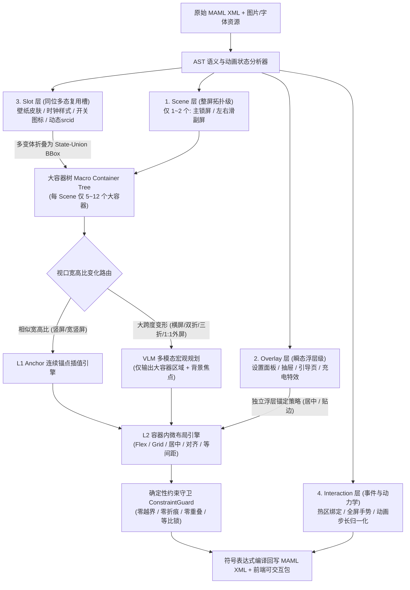
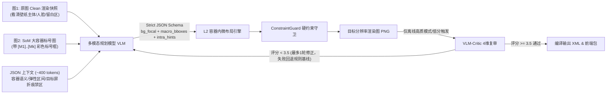
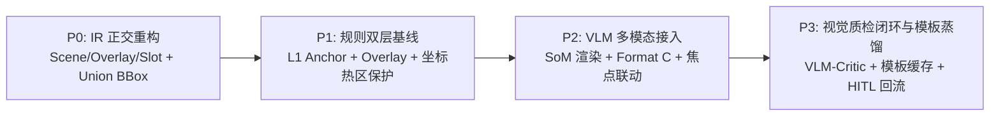
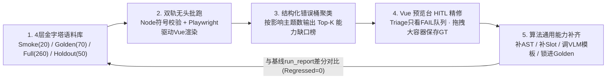
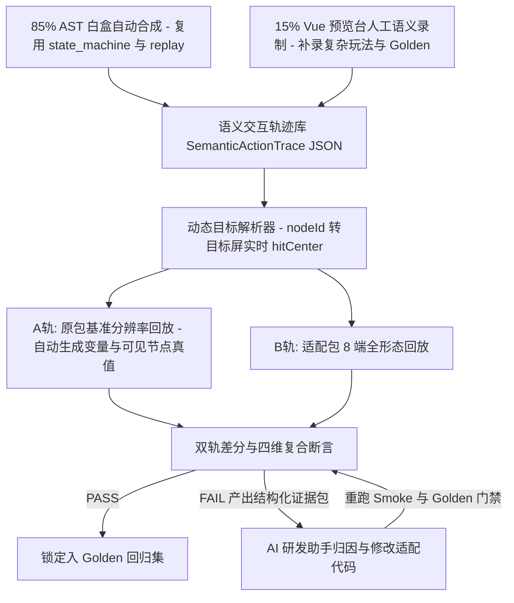
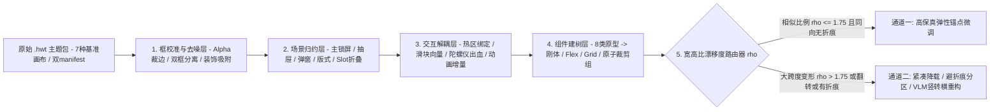
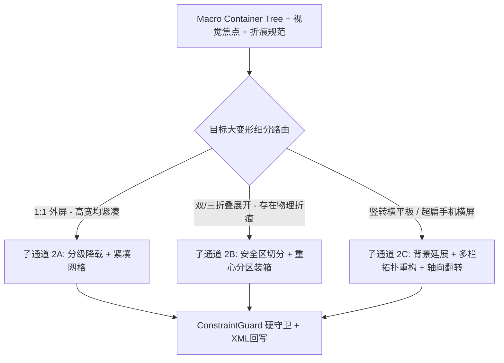
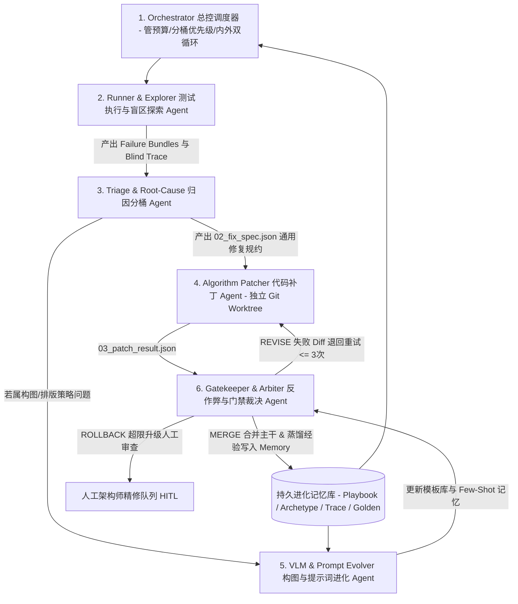

# 华为主题锁屏全形态多分辨率自适应系统 —— 技术架构与 P0–P3 工程落地规划

> **文档版本:** v2.0  
> **适用工程:** `hw_theme_adapter`（Node.js ES Modules 符号转义与布局编译器 + 多模态 VLM 规划层 + TS/Vue 实时预览测试闭环）  
> **目标范围:** 直板竖屏、华为 Pura X / Pura X MAX、折叠外屏 1:1、双折叠 Mate X6、三折叠 Mate XT（单/双/三屏）、MatePad 平板及手机横屏全形态自适应，支撑 400+ 真实 `.hwt` 主题包持续演进。

---

## 目录

- [第 1 章：项目目标、架构铁律与现状基线](#第-1-章项目目标架构铁律与现状基线)
- [第 2 章：核心抽象 —— 四层正交建模（Scene × Overlay × Slot × Interaction）与双层 Anchor](#第-2-章核心抽象--四层正交建模scene--overlay--slot--interaction与双层-anchor)
- [第 3 章：双层父子容器布局引擎（Macro Layout + Intra-Container Adaptation）](#第-3-章双层父子容器布局引擎macro-layout--intra-container-adaptation)
- [第 4 章：竖转横与折叠大变形的多模态（VLM）混合布局路线](#第-4-章竖转横与折叠大变形的多模态vlm混合布局路线)
- [第 5 章：P0 – P3 分阶段工程落地实施计划](#第-5-章p0--p3-分阶段工程落地实施计划)
- [第 6 章：400 套真实主题 × TS/Vue 实时预览器的迭代闭环测试与数据飞轮](#第-6-章400-套真实主题--tsvue-实时预览器的迭代闭环测试与数据飞轮)
- [第 7 章：主题全类型分类治理、组件框校准与「相似宽高比 vs 大跨度变形」细化架构](#第-7-章主题全类型分类治理组件框校准与相似宽高比-vs-大跨度变形细化架构)
- [第 8 章：多 Agent 协同与双轨自进化闭环迭代架构](#第-8-章多-agent-协同与双轨自进化闭环迭代架构)
- [第 9 章：附录 —— 现有工程目录索引与 CLI 速查手册](#第-9-章附录--现有工程目录索引与-cli-速查手册)

---

## 第 1 章：项目目标、架构铁律与现状基线

### 1.1 问题本质与目标边界

华为主题锁屏（MAML `.hwt` 包内的 `unlock/lockscreen/manifest.xml`）绝大多数以直板机竖屏（如 `1080×2400`、`1080×2340`、`1080×1920`、`1080×2600`）作为原始设计画布，脚本内大量存在：
- 写死像素坐标与固定距离的触控阈值；
- 同位置切换多个视觉状态的互斥图片组或动态 `srcid` 表达式；
- 隐藏在画布外（`±1080` 或 `±2400`）通过滑动或点击切入的二级面板、设置弹窗、引导页、充电特效；
- 深度绑定背景 IP 主体（如人物、3D 熊猫、水墨风景）的前景构图。

当同一套主题适配到 **8 种典型华为终端形态** 时，适配系统必须同时解决两类完全不同难度的问题：
1. **相似宽高比平滑适配**（如 `20:9` → `19.5:9` → `16:9` → Pura X `16:10`）：要求边缘锚点贴合、主视觉比例锁死、无多余裁切与无感对齐。
2. **大跨度形态与竖转横重排**（如 `1:1` 外屏、双折叠展开、三折叠三屏展开、平板/手机超宽横屏）：要求避让折叠折痕、识别左右双栏/三栏拓扑、保护背景主体人脸/IP 不被遮挡、并保持原有交互树 100% 可用。

### 1.2 华为全形态 5 断点设备矩阵

以物理宽高比归一化到虚拟画布宽度 `1080px` 后的视口宽高比 $ar = W / H$ 划分 5 个响应式断点：

| 断点枚举 (`breakpoint`) | 宽高比区间 | 代表华为设备 (`id`) | 物理分辨率 | 虚拟画布 (`w×h`) | 折痕禁区 (`hinges`) | 核心适配策略 |
|---|---|---|---|---|---|---|
| `portrait_tall` | $ar < 0.56$ | `phone_2400` / `phone_2340` / `mate_xt_single` | 1080×2400 / 1080×2340 / 1008×2232 | 1080×2400 / 1080×2340 / 1080×2391 | 无 | 顶部/底部安全锚点 + 纵向弹性比例插值 |
| `wide_portrait` | $0.56 \le ar < 0.78$ | `pura_x_portrait` / `pura_x_max_portrait` / `tablet_portrait` / `phone_1920` | 1320×2120 / 1828×2584 / 1600×2560 / 1080×1920 | 1080×1735 / 1080×1527 / 1080×1728 / 1080×1920 | 无 | L1 Anchor 宽高收放 + 居中安全比例缩放 |
| `square_fold` | $0.78 \le ar < 1.15$ | `pura_x_cover` (外屏) / `dual_fold_unfolded` / `tri_fold_dual` | 980×980 / 2240×2440 / 2048×2232 | 1080×1080 / 1080×1176 / 1080×1177 | 双折 `x=540 (w=44)`；外屏无折痕 | 外屏紧凑叠放 / 双折左右双屏折痕避让 |
| `landscape_tablet` | $1.15 \le ar < 1.85$ | `tri_fold_triple` / `tablet_land` / `pura_x_land` / `pura_x_max_land` | 3184×2232 / 2560×1600 / 2120×1320 / 2584×1828 | 1080×757 / 1080×675 / 1080×672 / 1080×764 | 三折 `x=360, 720 (w=32)` | 三屏分区 / 横屏双栏重排 / VLM 主体避让 |
| `landscape_wide` | $ar \ge 1.85$ | `phone_land` | 2400×1080 | 1080×486 | 无 | 超扁双栏横排 + Dock 两端贴边展开 |

### 1.3 四条系统架构铁律（全阶段不变量）

1. **原始资源包只读原则**：所有输入目录的原始 `.hwt` 严格只读，一切编译产物、重打包 `.hwt`、前端导出包与测试报告只输出到独立 `output/` 或 `runs/` 目录。
2. **交互逻辑零篡改原则**：编译期禁止删除、改写或强行重写 `<Trigger>`、`<VariableCommand>`、`<ExternCommand>`、`<IntentCommand>`、`<Var>`、`<Unlocker>`、`<Slider>` 的条件与赋值语义（要求 `mutatedLogicCount === 0`、`wipedDynamicGroupCount === 0`）。
3. **无 per-theme 硬编码原则**：所有 Scene 发现、Slot 折叠、容器合并、微布局重排与异常分桶规则，必须基于通用 MAML AST 与空间几何拓扑提取，严禁按主题文件名写特判分支。
4. **“生成必守卫”原则**：无论是确定性规则还是多模态 VLM 输出的宏观布局，必须经过 `ConstraintGuard` 进行几何硬约束校验与修正（`oob=0, ov=0, hinge=0, dist=0, btn=0, leak=0, nan=0`）后方可写入最终 XML。

### 1.4 当前工程基线（24 套真实主题实测数据）

当前 `hw_theme_adapter` 已完成符号编译底座、多形态断点求解、交互运行时引擎、Web Component 组件化与双层父子容器求解（`hierarchical_v1`），并经过全量验证：

| 验证维度 | 实测范围 | 当前基线结果 | 关键发现与待演进空间 |
|---|---|---|---|
| **单元测试** | `node --test` | **16 / 16 PASS** (`0` 失败) | 覆盖表达式 AST、符号重写、5 断点折痕、交互运行时、Web Components 与 Format C 大容器插件 |
| **通用规范校验 (`hwflex`)** | 24 主题 × 8 设备 = 192 用例 | **24 / 24 主题、192 / 192 PASS** | `xml=PASS`, `mut=0`, `wipedGrp=0`, `leak=0`, `hinge=0`, `oob=0`, `ov=0`, `nan=0` |
| **双层父子容器 (`hierarchical_v1`)** | 24 主题 × 8 设备 = 192 用例 | **24 / 24 主题、192 / 192 PASS** | **1,714** 个前景组件自动收敛为 **1,366** 个父容器（压缩比 **0.797**），生成 **169** 个多子项合并大容器 |
| **多交互状态响应分析 (`analyze`)** | 24 主题，共 **215** 个交互状态 × 8 设备 = **1,720** 单元 | **1,700 / 1,720 (98.84%) PASS**，`NaN = 0` | 20 个 WARN 精准暴露 3 大演进缺口：**14 例退场动画终点误判**、**5 例展开态跨折痕**、**3 例超宽横屏附加卡溢出** |
| **Scene / Slot 正交压缩潜力测算** | 24 主题全量审计 | **215** 状态 → **47** 真整屏 Scene (**1.96 态/主题**) | 1,714 前景组件经 Slot 折叠后主屏仅剩均值 **7.4 个大容器**（例：`五福临门` 105→14、`波蓝` 89→8、`暹罗厘普` 54→15） |

---

## 第 2 章：核心抽象 —— 四层正交建模（Scene × Overlay × Slot × Interaction）与双层 Anchor

传统多状态适配之所以陷入“状态组合爆炸”（单套主题动辄 8~12 个状态、上百个变体图层），根本原因在于把**内容替换态**与**整屏拓扑切换**混为一谈。本方案从 IR 层将锁屏拆解为正交的四个平面：**只有 Scene 需要独立做全局布局求解**。

### 2.1 四层正交架构全景图



### 2.2 Scene 层：严格收窄到“整屏空间拓扑切换”

**核心原则**：不是变量变了就是新 Scene；**只有视口空间坐标发生整屏级翻页或整屏内容替换，才成立新 Scene**。

1. **准入判定规则**：
   - `S_main`（主锁屏）：默认入口整屏，永远存在；
   - `S_paging`（左滑/右滑/上滑整屏副页）：仅当存在全屏级平移动画组（如 `pagingGroups` 位移跨越 `>= 0.75 * baseW` 或 `>= 0.65 * baseH`，典型变量如 `oneSec`、`sec_page`、`page`、`mjui_move_sxs`），才建立独立 Scene；
   - **严格排除**：普通局部弹窗、开关切换、主题皮肤更换、纯特效动画，**一律不得晋升为新 Scene**。
2. **实测收益**：24 套主题合计 `215` 个原始交互状态收敛至 `47` 个真整屏 Scene，平均每套主题仅 **`1.96` 个布局 Scene**（绝大多数只有 `主屏 + 1 个滑出负一屏`）。

### 2.3 Overlay 层：瞬态浮层与全屏特效解耦

24 套主题中有 **22 套** 包含设置弹窗、半屏滑窗抽屉、新手引导或充电光效。这类元素在交互上覆盖在当前 Scene 之上，**绝不应和主屏常驻卡片混在同一个二维槽位里争夺面积**，而应抽象为独立的 `overlays[]` 通道：

| `overlayKind` | 典型触发特征 | 宏观定位策略 | 尺寸与约束策略 | 前端对应组件 |
|---|---|---|---|---|
| `modal` (设置/功能弹窗) | `more_st / p_set / set_go / kzltc / tan\d`，多在主画面居中或下半区弹出 | 视口安全区内**居中放置** (`center`) | 等比包含 `min(0.92 * usableW / w0, 0.90 * usableH / h0)`；在双/三折叠上优先单面板内居中或跨中轴无字区 | `<hw-drawer direction="center">` |
| `drawer` (点击/侧滑滑窗) | `oneSec / kp_ani / drawer / cbl` 等带单向滑入轨迹的中大型容器 | 按滑入方向（`left / right / top / bottom`）**贴边停靠** | 宽屏/折叠下宽度上限钳制为 `min(singlePanelW, 0.48 * targetW)`，滑入位移归一化为 `±#__hw_sw` | `<hw-drawer direction="left\|right\|bottom\|top">` |
| `guide` (引导浮层) | `guide / tips / teach` | 安全区居中或指向性贴边 | 等比缩放且保留高优先级关闭按钮命中区 | `<hw-drawer direction="center">` |
| `charging_fx` (充电状态特效) | `battery_state / charge_anim / chongdian` | 与背景焦点 `(fx, fy)` 或底部充电头坐标绑定 | 全屏粒子/波纹随比例扩展；电量数字卡片独立保可读性 | 状态变量驱动层 |

### 2.4 Slot 层：同位多态复用槽与 State-Union BBox（关键突破）

在传统 MAML 制作中，设计师为了做“6 套壁纸切换”、“4 种时间风格”、“10 个快捷图标”或“手电筒开/关图标”，会堆叠几十到上百个仅 `visibility` 或 `srcid` 不同的节点。在正交模型中，它们全部折叠为 **1 个逻辑 Slot**：

1. **两类 Slot 的统一识别算法**：
   - **A 类 —— 隐式动态槽 (`srcid_container`)**：单个 `<Image>` 节点通过 `srcid` / `srcExp` 引用状态变量（例如 `北海` 含 96 处、`时间感知` 含 83 处、`比邻熊` 含 45 处）。枚举其控制变量值域，解析所有可能贴图尺寸并取**最大自然尺寸包络**。
   - **B 类 —— 显式互斥叠层槽 (`visibility_slot_container`)**：同一 Scene 内由状态变量互斥谓词（如 `eq(#v, 0)` vs `eq(#v, 1)`、`not(#v)`）控制、且空间高度重合（`IoU ≥ 0.25` 或中心距 $\le 0.55 \times \max(w, h)$）的同位置组件簇（典型如 `波蓝` 7 套背景 + 4 套数字 + 8 组时钟切换、`五福临门` `zjbg(6)`、`时透` `bght(12)`）。
2. **核心工程创新 —— State-Union BBox（状态并集包围盒）**：
   - **痛点**：在 24 套主题多状态检测中，发现 `华UI新`（音乐展开态 `S3_muv_ani_2`）和 `疯癫杀马特`（时间样式态 `S1_timestyle_1`）**默认态完全安全，切换到变宽态后反而撞上双折叠/三折叠折痕**。
   - **解法**：对同一 Slot 内的全部状态变体计算空间并集包络：
     $$\text{UnionBBox}(S) = \bigcup_{v \in \text{Variants}(S)} \text{BBox}(v)$$
     宏观布局引擎与 VLM 只面向 $\text{UnionBBox}(S)$ 做排布和折痕避让；编译期则让 Slot 下的所有变体节点**共享同一套变换变量**（`__hw_slot{k}_s / ox / oy`）。既彻底消灭切态越界与跨折痕，又使生成 XML 的注入 `<Var>` 数量下降 **60%~80%**。
3. **景深锁定前景层保护 —— Depth-Lock（`depth_foreground_locked`）**：
   - **痛点**：华为高阶景深主题（如 `景深双色鱼缸`、`五福临门` 及大量商业人像主题）通常由 **“背景底图 + 中间时钟文字 + 与背景全对齐的透明抠图前景层”** 三层叠出景深遮挡效果。若把该抠图前景层当成普通独立组件移动，横屏时人物抠图会与背景瞬间撕裂错位。
   - **解法**：凡尺寸覆盖画布 `>= 0.90 × baseW × baseH`、含透明通道且与背景全对齐的景深遮罩/抠图前景层，在正交模型中一律打标为 `depth_foreground_locked`，**强制与背景共用完全相同的 `cover` 缩放比例与 `(focalX, focalY)` 偏移**，绝不作为可自由移动的前景卡片暴露给布局引擎或 VLM。

### 2.5 Anchor 层：视口级 L1 锚点与容器级 L2 锚点

| 层级 | 作用范围 | 枚举/属性 | 适用形态与行为 |
|---|---|---|---|
| **L1 视口级 Anchor** | 大容器相对于屏幕安全区的位置关系 | `top_center`、`top_left`、`top_right`、`bottom_edges`、`center_focal`、`edge_bleed` | 主要支配**相似宽高比**（`portrait_tall` / `wide_portrait`）连续插值：`bottom_edges` 永远钉死底部安全边距并跟随宽度两端锚定；`center_focal` 与背景 `(fx, fy)` 联动偏移；`edge_bleed` 允许设计边缘自然出血不被硬拉入框内 |
| **L2 容器内 Anchor** | 子组件相对于其父容器 `targetBox` 的定位 | `align: start \| center \| end`、`justify: pack \| center \| space_between \| space_evenly`、`align_edges` | 主要支配**大跨度变形**（竖转横、双/三折、1:1 外屏）下的容器内子元素对齐、居中与等距重排 |

### 2.6 Interaction 层：零篡改保护与三类热区分治

1. **三类热区精准分治**：
   - **绑定视觉组件的 `<Button>`**：随所绑定 Slot / 大容器共享同一组仿射变换，确保按钮图形与可点热区在任何分辨率下像素级重合（`buttonDriftCount === 0`）。
   - **全屏手势 `<Button>`**：统一保持全屏范围 `x="0" y="0" w="#screen_width" h="#screen_height"`，保留原始上滑解锁、左右滑切屏阈值逻辑不变。
   - **坐标硬编码型交互（特殊历史写法）**：少数主题（如 `华UI新` 202 处、`北海` 78 处）直接在全屏 `<Button>` 触发器内通过 `#touch_x / #touch_y` 数值区间做命中判定。策略分两步：
     1. AST 阶段识别出区间常量 $[x_{\min}, x_{\max}] \times [y_{\min}, y_{\max}]$ 并自动绑定到对应区间的视觉区域（标记 `coordHardcoded: true`）；
     2. 布局阶段优先保护该区间的统一缩放与低偏移（或按所属大容器逆变换重写区间，定向模式精度 100%）。
2. **动态偏移与离场动画隔离**：
   - 分页滑窗的闭屏初始坐标统一除以原画布跨度，乘以 `#__hw_sw` / `#__hw_sh` 视口步长单位（`sceneLeakCount === 0`）；
   - 屏外出生动画粒子标记 `offscreen_ambient`，按比例缩放发射域；
   - 主动退场终点状态标记 `isExitTransition: true`，与常驻状态剥离校验（解决 `叠峰` `t_in=100`、`非凡之境` `drop_in=100` 等 14 例误报）。

### 2.7 前端标准化组件映射

在前端可视化预览与独立前端导出包中，交互结构统一抽象为两类零依赖原生 Web Components：
- **`<hw-drawer>`**：承载点击/滑动触发的抽屉与弹窗 Overlay（支持 `direction`、`open`、遮罩点击关闭与手势穿透）；
- **`<hw-image-switcher>`**：承载 Slot 容器内所有图片变体（预加载全部 `<figure class="hw-slot">`，通过 `active-value` 平滑渐变切图，彻底消除切态白屏/闪烁）。

### 2.8 本章可落地实施步骤（四层正交建模与双框 IR 落地清单）

| 步序 | 执行动作 | 目标文件 / 模块 | 具体实施细则与交付契约 | 完成验收门槛 |
| :---: | :--- | :--- | :--- | :--- |
| **Step 1** | **资产 Alpha 紧致扫描** | [image_meta.js](file:///f:/ThemeStidoUltra/theme_tmp/hw_theme_adapter/src/hwt/image_meta.js) | 在读取 PNG/WebP 文件头时顺带扫描 `alpha > 8` 最小非透明矩形 `trimBox = { l, t, r, b }`，按素材内容 SHA-1 做磁盘/内存双级缓存，纯透明占位图标 `isEmptyVisual: true` | 单主题冷扫描 `< 15ms`，缓存二次命中 `< 1ms` |
| **Step 2** | **双框 IR 与离线几何补强** | [transpiler.js](file:///f:/ThemeStidoUltra/theme_tmp/hw_theme_adapter/src/ir/transpiler.js) | 节点 IR 同时挂载 `rawBox`、`visualBox` 与 `trimOffset = { dl, dt, dr, db }`；补全 `rotation/pivot` 4 顶点仿射 AABB、`<Group clip="true">` / `<Mask>` 向下求交集，以及 `ImageNumber` 按字符集逐张累加实宽 | 消除全画布透明 PNG 框虚大、旋转错框与数字串偏移 |
| **Step 3** | **构建正交 IR 中枢** | 新建 `src/ir/orthogonal_model.js` | 导出 `buildOrthogonalModel()`：① `classifyTrueScenes()` 识别整屏翻页并建立 `Seam` 邻接图；② `extractOverlays()` 剥离弹窗/抽屉/充电光效；③ `buildSlotRegistry()` 折叠 `srcid` 与 `visibility`/`alpha` 互斥图并求 **State-Union BBox**；④ `markDepthLockedLayers()` 标记 3D 景深层；⑤ `tagExitTransitions()` 标记动画退场终态 | `node src/cli.js audit --all` 输出 `avg(trueScenes) ≤ 2.0`，Slot 折叠比提升 30%+ |
| **Step 4** | **写回反向补偿与共享变量** | [xml_compiler.js](file:///f:/ThemeStidoUltra/theme_tmp/hw_theme_adapter/src/compiler/xml_compiler.js) | 布局用 `visualBox`，XML 写回时按 `newRawX = vx' - dl * s`、`newRawY = vy' - dt * s` 执行反向补偿；同一 Slot 内 N 张互斥切图及绑定 `<Button>` 全员共享 1 组 `#__hw_cK_*` 变量，不冗余生成 `<Var>` | 注入 `<Var>` 数量下降 `80%+`，导出包静态核验零漂移、`mut === 0` |

---

## 第 3 章：双层父子容器布局引擎（Macro Layout + Intra-Container Adaptation）

为了同时解决“普通规则能稳定覆盖”与“多模态大模型能精准接管”两个需求，布局求解采用 **“Level-1 宏观大容器排布 + Level-2 容器内微布局适配”** 的分层体系。

### 3.1 父子容器合并策略（6 级合并优先级）

在每个 Scene 的 Slot 列表基础上，按如下优先级自顶向下构建父子容器树（同一 Slot 仅归属一个父容器）：

| 优先级 | 容器类型 (`kind`) | 识别与合并规则 | 默认容器内布局 (`intraLayout`) |
|---|---|---|---|
| **P1** | `custom_group` | 用户通过 `--merge` 配置或预览台拖拽/勾选手动合并的组件集合 | 由用户/模型显式指定 |
| **P2** | `dock_bar` | 同 Scene、兼容变体下底部 `dock_left / dock_center / dock_right` 水平不重叠且跨度 $\ge 0.45 \times \text{baseW}$ 的快捷图标组 | `flex_row`（双侧图标用 `space_between`，多图标用 `space_evenly`） |
| **P3** | `header_cluster` | 空间纵向邻接（间隙 $\le 0.14 \times \text{baseH}$）的 `clock + date + weather` 核心信息组 | 若内部无重叠则为 `flex_col` 并反推水平 `align`；若内部有美术叠字叠图则锁定 `proportional` |
| **P4** | `overlay_composite` | 同面板（`pane`）、同变体下有意相互重叠（重叠度 $\ge 35\%$）的复合图层（如卡片底图 + 角标 + 数值） | `proportional`（严禁拆散相对叠层） |
| **P5** | `widget_row` / `widget_grid` | 同变体下等高水平对齐的卡片行（高度比 $\le 1.8$、水平间距 $\le 0.14 \times \text{baseW}$），若多等长行纵向紧密堆叠则自动升级为网格 | 单行：`flex_row (space_evenly)`；多行等列：`grid_even (cols = N)` |
| **P6** | `singleton` | 其余未合并组件，统一包裹为单子项大容器 | `center_contain` |

### 3.2 二级容器内微布局原语（Level-2 `INTRA_LAYOUT_MODES`）

当 Level-1 为大容器 $M$ 分配目标矩形 $\text{targetBox} = (X, Y, W, H)$ 后，Level-2 扣除内边距 `padding` 得到内部可用框 $\text{inner} = (x_0, y_0, w_0, h_0)$，按以下 6 种确定性原语求解全部子组件变换（严格保证每个子项等比缩放 $s_x = s_y$）：

1. **`center_contain`（居中包含）**：
   $$s = \text{clamp}\left(\min\left(\frac{w_0}{\text{origW}}, \frac{h_0}{\text{origH}}\right),\, 0.03,\, 1.5\right)$$
   整体在 $\text{inner}$ 内水平垂直居中。
2. **`proportional`（比例保真容器）**：
   以统一尺度 $s$ 缩放整个容器并在 $\text{inner}$ 内居中，每个子项保持原始相对偏移 $(x_i - X_{\text{orig}}) \cdot s$，适合带有背景压花、不规则美术拼接的复合卡片。
3. **`flex_col`（纵向弹性栈）**：
   按原 $Y$ 序排列子项，求解满足最大子项宽约束与总高+等间距约束的最大统一缩放比：
   $$s = \min\left(\frac{w_0}{\max_i w_i},\, \frac{h_0 - \text{gap}\cdot(n-1)}{\sum_{i=1}^n h_i}\right)$$
   再按 `justify`（`pack` / `center` / `space_between` / `space_evenly`）计算 $y_i$，按 `align`（`start` / `center` / `end`）计算 $x_i$。
4. **`flex_row`（横向弹性行）**：
   按原 $X$ 序排列，求解 $s = \min\left(\frac{w_0 - \text{gap}\cdot(n-1)}{\sum w_i},\, \frac{h_0}{\max h_i}\right)$；支持 `space_between` 两端贴边与 `space_evenly` 等距分布，且内建 **单子项折痕避让**（小图标不骑线）。
5. **`grid_even`（均匀网格）**：
   按 `cols` 列数划分为 $R = \lceil n / \text{cols} \rceil$ 行网格，单元格尺寸 $(\text{cellW}, \text{cellH})$，每个子项等比缩放至单元格内并居中对齐；支持长宽比剧变时由 `2×2` 自动变为 `1×4` 或 `4×1`。
6. **`align_edges`（边缘比例锚定）**：
   保留每个子项在容器内到左/右/上/下边缘的归一化相对位置比例，在宽扁变形时保持角标贴角不漂移。

**安全防破坏熔断规则**：
- 若子项在原设计稿中存在有意重叠（重合率 $> 22\%$）且用户未强行指定拆散，自动回落为 `proportional`，防止把叠层设计强行拉开；
- 在 `portrait_tall` / `wide_portrait` 等同向竖屏且无显式覆写时，自动保持平滑比例对齐以继承原稿美感。

### 3.3 统一算法插件协议（`schema_version: 2.0 / 2.1`）

系统对外提供标准化的 JSON 请求/响应协议，同时兼容像素级控制（Format A/B）与面向大容器+VLM 的 **Format C**：

```json
// 请求端发送给外部算法 / VLM 的结构化上下文 (Request Schema v2.1)
{
  "schema_version": "2.1",
  "theme_name": "事事如意 3D熊猫",
  "source_canvas": { "w": 1080, "h": 2160 },
  "device": {
    "id": "dual_fold_unfolded",
    "breakpoint": "square_fold",
    "w": 1080,
    "h": 1176,
    "safeArea": { "top": 28, "right": 28, "bottom": 28, "left": 28 },
    "hinges": [{ "axis": "x", "pos": 540, "width": 44 }]
  },
  "scene": "main",
  "macro_containers": [
    {
      "id": "mc_1",
      "kind": "header_cluster",
      "label": "锁屏时间信息组 (3)",
      "pane": "left_primary",
      "bbox": [210, 180, 660, 340],
      "intraLayout": "flex_col",
      "align": "center",
      "coordHardcoded": false,
      "children": [
        { "id": "slot_clock", "role": "clock", "bbox": [210, 180, 660, 210], "variants": 1 },
        { "id": "slot_date", "role": "date", "bbox": [330, 410, 420, 52], "variants": 1 },
        { "id": "slot_weather", "role": "weather", "bbox": [360, 474, 360, 46], "variants": 3 }
      ]
    }
  ]
}
```

```json
// Format C 响应格式（由规则算法或 VLM 返回，仅操控大容器框 + 容器内微调参数）
{
  "coordinate_system": "normalized_1000",
  "layout_archetype": "avoid_center_subject_split",
  "bg_focal_point": [0.50, 0.36],
  "macro_bboxes": {
    "mc_1": [45, 75, 410, 360],
    "mc_2": [565, 110, 385, 480],
    "mc_3": [45, 830, 910, 120]
  },
  "container_overrides": {
    "mc_1": { "intraLayout": "flex_col", "align": "start", "justify": "center" },
    "mc_3": { "intraLayout": "flex_row", "align": "center", "justify": "space_between" }
  }
}
```

### 3.4 `ConstraintGuard` 确定性硬约束守卫

任何算法（规则引擎、外部 Python 脚本、VLM 大模型）返回的布局，编译前**必须经过 `ConstraintGuard` 的五道硬校验与自动修复**：
1. **等比锁死**：强行校准 $s_x = s_y = \min(s_x, s_y)$，任何非背景图片零拉伸畸变（`distortionCount === 0`）；
2. **折痕禁区排斥**：在双折（`x=540`）、三折（`x=360, 720`）设备上，扫描所有窄幅前景容器，若与折痕禁区交叠则向安全余量更大的一侧面板推离或微缩至单面板可用宽度内（`hingeStraddleCount === 0`）；
3. **安全区越界钳制**：非刻意边缘出血组件严禁超出 $[pad_x, W - pad_x] \times [pad_y, H - pad_y]$（`oobCount === 0`）；
4. **自适应碰撞消解与缩放退让**：在互兼容变体之间执行最多 28 轮沿最小重叠轴分离 + 必要时 `0.85×` 等比微缩，并在 Dock 栏之上建立内容底线（`overlapPairs === 0`）；
5. **交互热区联动校验**：确保每个 `<Button>` 命中盒与其绑定视觉组件的交并比不退化（`buttonDriftCount === 0`）。

### 3.5 本章可落地实施步骤（双层父子容器与硬约束守卫落地清单）

| 步序 | 执行动作 | 目标文件 / 模块 | 具体实施细则与交付契约 | 完成验收门槛 |
| :---: | :--- | :--- | :--- | :--- |
| **Step 1** | **装饰三级吸附与网格聚合** | [container_tree.js](file:///f:/ThemeStidoUltra/theme_tmp/hw_theme_adapter/src/layout/container_tree.js) | 聚类前先跑装饰吸附 Pass（紧邻贴纸并入宿主、角标绑四角、氛围碎标 P3）；改为以 `Slot` 为最小原子建树，并自动把 20~50 个并排切图按钮聚合成单个 `Grid / Flex Wrap` 选择器父容器 | 主屏大容器数量收敛至 `3~8` 个，消除零碎散点 |
| **Step 2** | **7 画布归一化与三带弹性锚点** | 新建 `src/layout/anchor_solver.js` | 将 7 种基准画布（`1920~2640`）统一归一化 `[0,1]`，反推隐式贴边/居中/底带锚点；实现 `Top Band / Middle Band / Bottom Band + Flex Spacer` 三带留白伸缩模型 | 相似竖屏区间（`ρ ≤ 1.75`）纯规则 `< 30ms` 出图，零畸变 |
| **Step 3** | **容器内自适应轴向翻转** | [container_tree.js](file:///f:/ThemeStidoUltra/theme_tmp/hw_theme_adapter/src/layout/container_tree.js) | 升级 `solveIntraContainerLayout()`：当父容器槽位宽高比 `> 1.8` 时自动触发 `flex_col ↔ flex_row`（时钟与日期并排、`2×2` 转 `1×4`）、超扁横屏底栏 Dock 转右侧竖栏；`1:1` 外屏按 `P0~P3` 分级降载 P3 装饰 | 平板/手机横屏文本与卡片纵高压缩 `40%+` 且零字号过小 |
| **Step 4** | **反塌缩守卫与预览同步修复** | [responsive_engine.js](file:///f:/ThemeStidoUltra/theme_tmp/hw_theme_adapter/src/layout/responsive_engine.js) & [index.html](file:///f:/ThemeStidoUltra/theme_tmp/hw_theme_adapter/src/preview/index.html) | 在 `ConstraintGuard` 加入 `avgScale ≥ 0.55`、前景占屏比 `12%~68%`、热区 `≥ 96px` 反塌缩护栏；修复预览台 `#showBbox` 剔除 `button/clippedOut` 及 `#showContainers` 随 `activeStateId` 动态刷新，补上「视觉实线框 vs 原始虚线框」切换开关 | `validate --all --algo hierarchical_v1` 192/192 PASS，预览框切态零滞后 |

---

## 第 4 章：竖转横与折叠大变形的多模态（VLM）混合布局路线

### 4.1 为什么 VLM 必须锁定在“5~12 个大容器”粒度

直接把 XML 或上百个零散节点交给多模态大模型存在三大死穴：Token 冗长易漏节点、无法理解复杂互斥变体、像素微调极易出现 5~10px 的叠压或越界。
经由第 2~3 章的 **Slot 折叠 + 大容器抽象** 后，单屏对象数量从 `50~200 个` 骤降至 **`5~12 个` 语义大容器**。此时 VLM 只需回答 4 个纯粹的视觉与语义问题：
1. 背景核心主体（人物面部、3D 角色、宠物、标志物）在原图哪块区域？横屏裁切时应该保住哪个焦点 `[fx, fy]`？
2. 目标宽屏/折叠屏更适合哪种空间拓扑结构（如左文右卡、左右避让中心人物、三折叠左时中画右组件）？
3. 这 `5~12 个` 大容器分别摆在哪个 `0~1000` 归一化区域？
4. 哪些长容器需要顺势切换内部排列（如竖栈变横排、2×2 变 1×4）？哪些非核心装饰在 `1:1` 小外屏上允许弱化降载？

### 4.2 多模态输入规范（双图 + 极简上下文）



1. **图 1（Clean Render）**：在标准设计分辨率下关闭所有辅助线渲染出的原貌图，帮助 VLM 做视觉显著性与人脸/主体保护判断；
2. **图 2（Set-of-Mark 标注图）**：仅框出折叠后的 `[M1]..[Mk]` 大容器边框与高对比度角标，避免细碎子元素标签遮挡视觉；
3. **结构化文本（约 300~600 Tokens）**：传给 VLM 每个 `[Mi]` 的语义角色、子组件数、长宽比弹性区间、以及目标屏的安全区与折痕坐标范围（例如：`双折叠折痕禁区 x ∈ [480, 520]，禁止任意 [Mi] 跨越该区间`）。

### 4.3 Prompt 约束、结构化构图 DSL 与容错机制

- **强制思考链（先定焦点与主体区域，再下坐标）**：要求 JSON 中先输出 `subject_bbox_orig`（背景核心主体框）和 `bg_focal_point`（背景 `cover` 焦点），再输出布局决策，强迫 VLM 在排布容器前先意识到背景主体所在；
- **可微调的构图原型与槽位分配 DSL（优先于纯裸坐标，降低坐标漂移）**：
  - VLM 直接预测绝对像素框常出现轻微不齐（例如左框 `x=42`、底框 `x=47`）。因此优先引导 VLM 从预置的 **5~6 种可读宏观构图原型**（如 `two_col_45_55`、`three_panel_fold`、`center_hero_split`、`compact_cover_top_bottom`）中做选择并输出 **槽位归属（`slotAssignment: { left: ['mc_1'], right: ['mc_2'], bottom: ['mc_3'] }`）**，仅在非标准创意构图时才输出自由 `macro_bboxes`；
  - 由确定性布局网格接管对齐与安全边距计算，VLM 专注做好“把谁放哪、躲开谁的脸、选哪个容器内排列”；
- **Multi-Viewport 单次联合规划（降本提速 3×）**：针对 `dual_fold`、`tri_fold`、`tablet_land` 三个宽屏断点，允许在一次 VLM 调用中同时请求输出三个断点的构图方案，将单主题多模态 API 调用次数压减 2/3；
- **硬坐标域规范**：当使用自由 `macro_bboxes` 时，全部坐标强制使用 `0~1000` 整数归一化域（`normalized_1000`），大幅降低浮点幻觉；
- **三层容错兜底**：
  1. JSON 解析容错（剥离 Markdown fence、提取最外层 `{}`）；
  2. 缺失大容器自动由 `hierarchical_v1` 补全；
  3. 若 VLM 服务超时、限流或返回不可修复方案，直接无感降级到 P1 `hierarchical_v1` 规则结果，保证流水线 **100% 可用**。

### 4.4 VLM-Critic 四维复审闭环

在离线高质量构建或全量盲测阶段，将最终渲染图与原图一起输入轻量 VLM-Critic，按以下 4 项指标打分（1~5 分）：
1. **`subject_occlusion_score`（主体避让分）**：前景大容器是否压住背景中人物眼睛/人脸/核心 IP；
2. **`visual_balance_score`（构图平衡分）**：左右/三栏视觉重量是否失衡或大面积堆在一角；
3. **`readability_score`（可读性分）**：文字/时钟在目标屏上是否过小、或因背景撞色难以辨认；
4. **`hinge_comfort_score`（折痕舒适度分）**：双折/三折折痕附近是否留有舒适呼吸感。

总均分 $< 3.5$ 或存在明确主体遮挡时，自动提取结构化修改建议（如 *"mc_1 遮挡了熊猫头部，请向右下角 `[560, 420, 380, 300]` 移动"*）回传 VLM 重算 **1 轮**；若仍不通过则回退确定性模板或加入人工精修队列。

### 4.5 分发产物路由：通用单包 XML vs 定向设备包

| 分发策略 | 适用场景 | VLM 触发策略 | 编译产出物 |
|---|---|---|---|
| **通用自适应单包 (`mode: universal`)** | 华为主题商店单包适配所有机型 | 仅对 **4 个代表形态断点**（`pura_x_cover`、`dual_fold_unfolded`、`tri_fold_triple`、`phone_land`）各规划一次宏观布局；`portrait_tall` / `wide_portrait` 走 L1 Anchor 连续插值 | 单份动态响应式 `manifest.xml`（含 `#__hw_ar` 断点表达式分支） |
| **机型定向分发包 (`mode: target`)** | 针对特定机型（如 Pura X 外屏、Mate XT 三屏、车机横屏）定制极致效果 | 直接按目标物理/虚拟分辨率 $W \times H$ 精确执行一次 VLM + L2 精算 | 极简静态表达式 `manifest.xml` + 定向重打包 `.hwt` + 独立前端交互包 |

### 4.6 本章可落地实施步骤（多模态 VLM 混合通道落地清单）

| 步序 | 执行动作 | 目标文件 / 模块 | 具体实施细则与交付契约 | 完成验收门槛 |
| :---: | :--- | :--- | :--- | :--- |
| **Step 1** | **补齐双轴焦点与氛围延展** | [xml_compiler.js](file:///f:/ThemeStidoUltra/theme_tmp/hw_theme_adapter/src/compiler/xml_compiler.js) | 扩展背景 `cover` 支持水平/垂直双轴断点独立焦点 `(focalX, focalY)`；当竖图转横屏纵向/横向裁切 `> 55%` 时，自动生成主色梯度 + 高斯模糊镜面两侧延展（Ambient Blur Canvas） | 强主体横屏零切头/切脚，零未保护黑边 |
| **Step 2** | **构建 SoM 渲染与 Prompt DSL** | 新建 `src/vlm/som_renderer.js` & `src/vlm/layout_prompt.js` | 生成原图 `clean` 与大容器 `[M1]..[Mk]` 色块标号图 `som_marked`；实现 Multi-Viewport 合并 Prompt（1 次请求输出 4 个大变形断点区划 + `slotAssignment` + `bg_focal_point`）与 JSON 自动修复器 | Prompt 输入压缩在 `≤ 15 个` 宏观项内，JSON 解析成功率 `100%` |
| **Step 3** | **视觉客户端与缓存落地** | 新建 `src/vlm/vlm_client.js` & `src/vlm/archetype_cache.js` | 统一 OpenAI-Compatible Vision / `mock` / `replay` 协议并接入 `sha256(astSig+device+promptVer)` 本地响应缓存与构图原型指纹库 `cache/vlm_archetypes.json` | 离线 `mock` 单测 100% 通过，模板复用 `< 200ms` |
| **Step 4** | **插件接入与 Critic 校准** | 新建 `src/layout/vlm_layout_plugin.js` & `src/vlm/critic_loop.js` | 注册 `vlm_hybrid` 算法：仅 `Tier 3/4` 触发，结果必过 `ConstraintGuard` 并在超时/超限时无感降级 `hierarchical_v1`；`VLM-Critic` 引入 20 张锚定图做 `Pairwise` A/B 校准，均分 `< 3.5` 自动重算 1 轮 | 6 套强主体样板主题横屏/折叠硬指标 `100% PASS` 且 Critic `≥ 4.0` |

---

## 第 5 章：P0 – P3 分阶段工程落地实施计划



### 5.1 P0：IR 正交重构（`Scene × Overlay × Slot` + State-Union BBox）

- **目标**：消灭状态组合爆炸与展开态跨折痕，将全量主题平均布局场景收敛至 $\le 2.0$、主屏大容器均值 $\le 10$。
- **涉及模块改造**：

| 动作 | 目标文件 | 核心实现内容与函数契约 |
|---|---|---|
| **新建** | `src/ir/orthogonal_model.js` | 导出 `buildOrthogonalModel(doc, themeDOM, assetIndex, stateMachine, uiComponents)`：<br/>1) `classifyTrueScenes()`：仅将整屏分页平移组晋升为布局 Scene；<br/>2) `extractOverlays()`：将 `modal / drawer / guide / charging_fx` 剥离至 `overlays[]`；<br/>3) `buildSlotRegistry()`：聚合隐式 `srcid/srcExp` 与显式互斥叠层组件为统一 Slot，计算所有变体的 **State-Union BBox**；<br/>4) `markDepthLockedLayers()`：识别与背景全对齐的透明景深抠图层为 `depth_foreground_locked`；<br/>5) `tagExitTransitions()`：为动画离场终点变量（如 `t_in=100`、`drop_in=100`）打 `isExitTransition: true` |
| **修改** | [container_tree.js](file:///f:/ThemeStidoUltra/theme_tmp/hw_theme_adapter/src/layout/container_tree.js) | `buildContainerTree()` 升级为以 `orthogonalModel.scenes[sc].slots` 作为最小装配单元（不再把同一 Slot 下的互斥皮肤拆进多个大容器），使大容器均值再降 30%~60% |
| **修改** | [xml_compiler.js](file:///f:/ThemeStidoUltra/theme_tmp/hw_theme_adapter/src/compiler/xml_compiler.js) | 同一 Slot 下多个互斥变体组件及绑定按钮复用同一套 `__hw_c{k}_s / tx / ty / ox / oy` 变量，消减冗余 `<Var>` 注入并保证全变体严格共对齐 |
| **修改** | [cli.js](file:///f:/ThemeStidoUltra/theme_tmp/hw_theme_adapter/src/cli.js) | `audit --all` 增加 `trueScenes / overlays / slots / macroContainers` 列 |

- **P0 自动化验收门禁**：
  - 运行 `node --test` 新增正交模型与 Union BBox 单测全通过；
  - 运行 `node src/cli.js audit --all`：24 套主题 `avg(trueScenes) ≤ 2.0`、`avg(mainMacroContainers) ≤ 10`；
  - 运行 `node src/cli.js validate --all --algo hierarchical_v1`：**24/24、192/192 PASS**；
  - 运行 `node src/cli.js analyze --all`：因展开/切样式导致的折痕跨越警告（`华UI新`、`疯癫杀马特`）从 5 例降至 **0**。

### 5.2 P1：规则双层基线增强（L1 Anchor + Overlay 通道 + 坐标热区保护）

- **目标**：确立零外部依赖的高可靠兜底引擎，使常驻交互态跨设备通过率提升至 $\ge 99.5\%$。
- **涉及模块改造**：

| 动作 | 目标文件 | 核心实现内容与函数契约 |
|---|---|---|
| **新建** | `src/layout/anchor_solver.js` | 导出 `inferMacroAnchor(container, baseCanvas)` 与 `solveByAnchors(containers, baseCanvas, targetDev, bgFocal)`：在 `portrait_tall` / `wide_portrait` 区间提供基于 9 宫格 Anchor + 背景焦点联动的平滑定位 |
| **修改** | [responsive_engine.js](file:///f:/ThemeStidoUltra/theme_tmp/hw_theme_adapter/src/layout/responsive_engine.js) | 在 `solveHierarchicalScene()` 中为 P0 拆出的 `overlays[]` 走独立浮层布局通道（`modal` 居中、`drawer` 贴边防折痕、`charging_fx` 焦点居中），不挤占主屏大容器空间 |
| **修改** | [container_tree.js](file:///f:/ThemeStidoUltra/theme_tmp/hw_theme_adapter/src/layout/container_tree.js) | `solveIntraContainerLayout()` 增加 `autoFlow` 宽高比自适应切换（极扁横屏下 `flex_col` 转 `flex_row`、网格自适应重算 `cols`）与极小外屏次要装饰降载策略 |
| **修改** | [interaction_adapter.js](file:///f:/ThemeStidoUltra/theme_tmp/hw_theme_adapter/src/interaction/interaction_adapter.js) | 提取全屏 `<Button>` 触发器内硬编码 `#touch_x / #touch_y` 命中区间，为关联容器标记 `coordHardcoded: true` 约束提示 |
| **修改** | [validator.js](file:///f:/ThemeStidoUltra/theme_tmp/hw_theme_adapter/src/validator/validator.js) & [state_machine.js](file:///f:/ThemeStidoUltra/theme_tmp/hw_theme_adapter/src/interaction/state_machine.js) | 多状态分析区分“退场过渡态 (`isExitTransition`)”与“常驻交互态”，并校验大容器联合包围盒的稳定度 |

- **P1 自动化验收门禁**：
  - `node src/cli.js validate --all --algo hierarchical_v1` **24/24、192/192 PASS**；
  - `node src/cli.js analyze --all` 常驻交互态 × 设备通过率 **≥ 99.5%**（`hinge = 0`、`nan = 0`）。

### 5.3 P2：VLM 多模态宏观规划接入（SoM 标注 + 契约适配 + 无感降级）

- **目标**：在大跨度变形设备上接入 VLM 做语义避让与全局构图重排，并与本地容器微布局无缝联动。
- **涉及模块改造**：

| 动作 | 目标文件 | 核心实现内容与函数契约 |
|---|---|---|
| **新建** | `src/vlm/som_renderer.js` | 导出 `renderSceneForVlm({ doc, themeDOM, assetIndex, orthogonalModel, containerTree, scene, outDir })`：生成内嵌真实资源的 SVG/PNG 原图 (`clean`) 与大容器标号图 (`som_marked`，带 `[M1]..[Mk]` 标签与色块) |
| **新建** | `src/vlm/layout_prompt.js` | 导出 `buildVlmPrompt(requestV21)` 与 `parseAndRepairVlmResponse(rawText, requestV21)`：生成带折痕禁区说明的系统提示词，校验并修复大模型输出 JSON（字段补全、坐标 `[0..1000]` 合法化） |
| **新建** | `src/vlm/vlm_client.js` | 导出 `callVlmPlanner({ cleanImg, somImg, prompt, config })`：统一适配 OpenAI Vision 兼容接口（Qwen-VL / GPT-4o / vLLM）、Gemini API 及本地 `mock` / `replay` 离线回放模式 |
| **新建** | `src/layout/vlm_layout_plugin.js` | 注册算法 `vlm_hybrid`：仅对 `square_fold / landscape_tablet / landscape_wide` 触发 VLM；解析 `bg_focal_point` 回填背景组件 `focalX/focalY`；若超时或失败自动降级回 `hierarchical_v1` |
| **修改** | [xml_compiler.js](file:///f:/ThemeStidoUltra/theme_tmp/hw_theme_adapter/src/compiler/xml_compiler.js) | **前置改造**：补齐背景 `cover` 对齐的水平视觉焦点 `focalX` 与断点独立焦点（目前水平方向居中 `(#__hw_sw - w0*s)/2`，仅垂直方向支持 `focalY`），使横屏与双折可按 VLM 输出同时保住左右/上下主体焦点 |
| **修改** | [server.js](file:///f:/ThemeStidoUltra/theme_tmp/hw_theme_adapter/src/preview/server.js) & [index.html](file:///f:/ThemeStidoUltra/theme_tmp/hw_theme_adapter/src/preview/index.html) | 增加 `/api/theme/:name/vlm-plan` 接口，工作台可展示 SoM 标注图、VLM 构图理由 `rationale` 与背景焦点十字准星 |

- **P2 自动化验收门禁**：
  - 离线 `mock` 模式下 `node --test` 新增 VLM Schema 校验、背景焦点 `cover` 偏移及超时回退测试全部通过；
  - 真实 VLM 抽测 6 套强背景主体主题（如 `事事如意 3D熊猫`、`比邻熊 新拟态`、`蜡笔小新夏日感知(1)`、`蜘蛛侠`、`波蓝`、`假日特调青柠气泡`）在 `tablet_land / dual_fold / tri_fold / phone_land` 全部硬指标 **100% PASS**。

### 5.4 P3：视觉质检闭环、模板蒸馏与 HITL 回流

- **目标**：构建低成本、自进化的模板复用与人工反馈闭环。
- **涉及模块改造**：

| 动作 | 目标文件 | 核心实现内容与函数契约 |
|---|---|---|
| **新建** | `src/vlm/critic_loop.js` | 导出 `runVlmCritic({ origCleanImg, adaptedCleanImg, macroBoxes, device })`：返回 4 维评分与结构化修正指令；低于 `3.5` 分或检测到主体遮挡时触发最多 1 轮修正循环 |
| **新建** | `src/vlm/archetype_cache.js` | 导出 `computeLayoutFingerprint(orthogonalModel, containerTree, bgSaliencyGrid)` 与模板检索/写入缓存（`cache/vlm_archetypes.json`），相似主题直接 `< 200ms` 复用高分构图模板 |
| **修改** | [server.js](file:///f:/ThemeStidoUltra/theme_tmp/hw_theme_adapter/src/preview/server.js) & [index.html](file:///f:/ThemeStidoUltra/theme_tmp/hw_theme_adapter/src/preview/index.html) | 预览画布支持直接拖拽/缩放父容器框实时触动 L2 重排，点击 **「保存为标准方案」** 导出标准化 `gt_record.jsonl` 样本并写入模板缓存 |
| **修改** | [cli.js](file:///f:/ThemeStidoUltra/theme_tmp/hw_theme_adapter/src/cli.js) | 新增 `benchmark --all --compare hwflex,hierarchical_v1,vlm_hybrid` 生成全维度对照评分报表 |

- **P3 自动化验收门禁**：
  - 重复全量批处理缓存命中率 `≥ 60%`；
  - 命中缓存的单主题全形态适配 `< 300ms`；
  - Ground-Truth 样本可直接回流为回归测试断言与 Few-Shot 检索案例。

### 5.5 启动前核心选型建议

| 决策项 | 推荐选型 | 理由 |
|---|---|---|
| **首期开发顺序** | **P0 → P1 先落地，P2 用 Mock 接口同步联调** | 先用纯本地工程把 `Scene / Overlay / Slot + Union BBox + L1 Anchor` 底座夯实，P2 多模态接口契约提前锁定便于并行接入 |
| **默认编译产物模式** | 平时研发评测优先跑 `target` 定向模式；上线打包跑 `universal` 通用单包模式 | `target` 模式产出极简静态表达式、调试因果清晰；`universal` 模式一份 `.hwt` 覆盖全系华为机型 |
| **VLM 接入形态** | 采用 `OpenAI-Compatible Vision API` 统一协议 + 本地 Mock 缓存 | 无论是接内部私有 VLM 服务（vLLM/SGLang 部署 Qwen-VL）还是商业 API（GPT-4o / Gemini），均无需改动主流程代码 |

---

## 第 6 章：400 套真实主题 × TS/Vue 实时预览器的迭代闭环测试与数据飞轮

拥有本地 **TS + Vue 保密实时预览项目** 和 **400 套真实主题包**，可以把“靠人工肉眼逐个调”升级为**自动化全量回归 → 失败根因聚类 → Vue 工作台精修回流 → 盲测对比发版**的工业级算法演进飞轮。

### 6.1 五环迭代飞轮总览



> **核心工程原则**：每次迭代严格遵循 **“不为一套主题写特判，只解决影响面最大的 Top-1~2 个通用错误桶”**，每次修完把典型样本锁进 `Golden` 集防退化，大版本发布再跑 `Holdout` 集检验真实泛化能力。

### 6.2 400 套真实主题的 4 层金字塔分层规范

通过一份 `dataset_manifest.json` 划分 400 套主题（总评测规模约 $400 \times 8 \times 2 \approx 6400$ 视图）：

| 测试层级 | 样本规模 | 筛选与维护策略 | 执行触发时机 | 单次目标耗时 |
|---|---:|---|---|---|
| **L0 冒烟集 (`smoke`)** | 15 ~ 20 套 | 手工挑选覆盖全生态特性的代表包（全屏翻页、大量 `srcid`/叠层 Slot、硬编码坐标点击、3D/IP 主体背景、极密多卡、充电/音乐/引导态） | 每次提交代码 / 修改布局或表达式引擎 | `< 30s` |
| **L1 黄金回归集 (`golden`)** | 60 ~ 80 套（只增不减） | 历史上每次修复过的典型 Bad Case + 经人工在 Vue 里精修确认过的标准方案样本 | 每次合并主干前（硬门禁，要求 `Regressed === 0`） | `2 ~ 3 min` |
| **L2 全量挖掘集 (`full`)** | ~250 套 | 其余全部可用开发语料，专门用来暴露罕见 MAML 语法、异常动画、极端长宽比溢出 | 每日夜间构建 / 每周能力迭代前 | `10 ~ 20 min`（4~8 并发） |
| **L3 盲测保留集 (`holdout`)** | **50 套（永久锁定隔离）** | 按主题品类分层随机抽取后封存，**严禁开发人员查阅或针对性写规则/Prompt** | 仅在版本里程碑/接入新 VLM 时统一跑一次对比 | `3 ~ 5 min` |

### 6.3 保密 TS/Vue 预览项目接入：`window.__HW_TEST_BRIDGE__` 完整契约

在公司保密的 Vue 预览仓库内，无需改动现有业务逻辑，仅新建两个独立调试文件并在入口通过 `import.meta.env.VITE_ENABLE_TEST_BRIDGE === 'true'` 条件挂载（**生产包自动 Tree-Shaking 零残留**）。

#### 文件 1：`src/testing/bridge.types.ts`（完整 TypeScript 协议定义）

```ts
export interface HingeSpec {
  axis: 'x' | 'y';
  pos: number;    // 虚拟画布坐标系下的折痕中心位置
  width: number;  // 折痕安全避让宽度
}

export interface ViewportSpec {
  deviceId: string;
  w: number;      // 逻辑/虚拟画布宽，例如 1080
  h: number;      // 逻辑/虚拟画布高，例如 2400 / 1176 / 675
  dpr?: number;   // 测试统一固定 1，避免截图尺寸翻倍
  hinges?: HingeSpec[];
}

export interface ThemeLoadOptions {
  /** 本地静态服务提供的 .hwt 地址（避免 base64 撑爆 IPC） */
  hwtUrl: string;
  /** 可选：直接覆盖包内 unlock/lockscreen/manifest.xml */
  manifestXmlOverride?: string;
  /** 固定时间与系统状态，确保截图像素级可复现 */
  mockEnv?: {
    timestampMs?: number;     // 例：Date.parse('2026-11-22T10:08:00')
    batteryLevel?: number;    // 例：85
    batteryState?: number;    // 0 未充电, 1 充电中
    weatherTemp?: number;     // 例：24
    steps?: number;           // 例：5200
  };
}

export interface RectBox {
  x: number;
  y: number;
  w: number;
  h: number;
}

export interface RenderedNodeMetric {
  nodeId: string;
  tag: string;
  name?: string;
  /** 归一化回虚拟画布 (0..w, 0..h) 坐标系的真实渲染包围盒 */
  bbox: RectBox;
  visible: boolean;
  opacity: number;
  zIndex: number;
  asset?: {
    src: string;
    loaded: boolean;
    naturalW: number;
    naturalH: number;
  };
  text?: {
    content: string;
    renderedFontSizePx: number;
    isOverflowClipped: boolean;
  };
  macroContainerId?: string;
  slotId?: string;
}

export interface RenderedSnapshot {
  themeId: string;
  deviceId: string;
  viewport: { w: number; h: number };
  /** 锁屏舞台在浏览器视口内的真实像素矩形（Playwright 用于精确 clip 截图） */
  stageClientRect: RectBox;
  activeVars: Record<string, number | string>;
  nodes: RenderedNodeMetric[];
  hitboxes: Array<{
    buttonNodeId: string;
    bbox: RectBox;
    isFullscreen: boolean;
    visible: boolean;
  }>;
  diagnostics: {
    brokenAssets: string[];
    nanExprCount: number;
    clippedTextNodes: string[];
    runtimeErrors: string[];
  };
}

export interface GestureSpec {
  type: 'tap' | 'double' | 'long' | 'swipe';
  /** 虚拟画布坐标系 */
  x: number;
  y: number;
  endX?: number;
  endY?: number;
  durationMs?: number;
}

export interface GestureResult {
  beforeVars: Record<string, number | string>;
  afterVars: Record<string, number | string>;
  changedVars: Record<string, { from: unknown; to: unknown }>;
  unlocked?: boolean;
  launchedIntent?: string | null;
  runtimeErrors: string[];
}

export interface OverlayConfig {
  mode: 'clean' | 'som' | 'hitboxes' | 'hinges';
  macroBoxes?: Array<{
    id: string;
    label: string;       // 如 "M1"
    role: string;        // 如 "header_cluster"
    bbox: RectBox;
  }>;
}

export interface HwTestBridge {
  readonly version: '1.0';
  ping(): { ready: boolean; rendererType: 'dom' | 'canvas' | 'hybrid' };
  loadTheme(options: ThemeLoadOptions): Promise<{
    themeId: string;
    baseCanvas: { w: number; h: number };
    loadTimeMs: number;
  }>;
  /** 同包热替换 manifest.xml（免重新解压贴图资源，提速 5~10 倍） */
  hotSwapManifest(manifestXml: string): Promise<{ swapTimeMs: number }>;
  setViewport(spec: ViewportSpec): Promise<void>;
  setVars(vars: Record<string, number | string>, replaceAll?: boolean): Promise<void>;
  setOverlay(cfg: OverlayConfig): Promise<void>;
  waitUntilSettled(opts?: { timeoutMs?: number; stableFrames?: number }): Promise<void>;
  collectSnapshot(): Promise<RenderedSnapshot>;
  dispatchGesture(gesture: GestureSpec): Promise<GestureResult>;
  disposeCurrentTheme(): Promise<void>;
}

declare global {
  interface Window {
    __HW_TEST_BRIDGE__?: HwTestBridge;
  }
}
```

#### 文件 2：`src/testing/installTestBridge.ts`（最小侵入宿主胶水层）

```ts
import { nextTick } from 'vue';
import type {
  GestureResult, GestureSpec, HwTestBridge, OverlayConfig,
  RenderedSnapshot, ThemeLoadOptions, ViewportSpec,
} from './bridge.types';

/** 宿主项目只需实现这组极简 Store 回调即可对接，DOM 与 Canvas 渲染器均兼容 */
export interface PreviewHostAdapter {
  rendererType: 'dom' | 'canvas' | 'hybrid';
  getStageElement: () => HTMLElement | null;
  loadHwtFromUrl: (opts: ThemeLoadOptions) => Promise<{ themeId: string; baseW: number; baseH: number }>;
  replaceManifestXml: (xml: string) => Promise<void>;
  applyViewport: (spec: ViewportSpec) => Promise<void>;
  applyVars: (vars: Record<string, number | string>, replaceAll: boolean) => Promise<void>;
  readVars: () => Record<string, number | string>;
  applyOverlay: (cfg: OverlayConfig) => Promise<void>;
  collectMetrics: () => Promise<Omit<RenderedSnapshot, 'stageClientRect' | 'diagnostics'> & { nanExprCount?: number }>;
  triggerGesture?: (g: GestureSpec) => Promise<{ unlocked?: boolean; launchedIntent?: string | null }>;
  disposeTheme: () => Promise<void>;
}

export function installTestBridge(adapter: PreviewHostAdapter): () => void {
  const runtimeErrors: string[] = [];
  const onErr = (e: ErrorEvent) => runtimeErrors.push(e.message || String(e.error));
  const onRej = (e: PromiseRejectionEvent) => runtimeErrors.push(String(e.reason));
  window.addEventListener('error', onErr);
  window.addEventListener('unhandledrejection', onRej);

  async function waitFrames(n: number) {
    for (let i = 0; i < n; i++) {
      await new Promise<void>(r => requestAnimationFrame(() => r()));
    }
  }

  const bridge: HwTestBridge = {
    version: '1.0',
    ping: () => ({ ready: true, rendererType: adapter.rendererType }),

    async loadTheme(options) {
      runtimeErrors.length = 0;
      const t0 = performance.now();
      const res = await adapter.loadHwtFromUrl(options);
      await bridge.waitUntilSettled();
      return { themeId: res.themeId, baseCanvas: { w: res.baseW, h: res.baseH }, loadTimeMs: Math.round(performance.now() - t0) };
    },

    async hotSwapManifest(xml) {
      runtimeErrors.length = 0;
      const t0 = performance.now();
      await adapter.replaceManifestXml(xml);
      await bridge.waitUntilSettled();
      return { swapTimeMs: Math.round(performance.now() - t0) };
    },

    async setViewport(spec) {
      await adapter.applyViewport(spec);
      await bridge.waitUntilSettled();
    },

    async setVars(vars, replaceAll = false) {
      await adapter.applyVars(vars, replaceAll);
      await bridge.waitUntilSettled({ stableFrames: 2 });
    },

    async setOverlay(cfg) {
      await adapter.applyOverlay(cfg);
      await waitFrames(2);
    },

    async waitUntilSettled({ timeoutMs = 4000, stableFrames = 3 } = {}) {
      await nextTick();
      const stage = adapter.getStageElement();
      const deadline = Date.now() + timeoutMs;
      if (document.fonts?.ready) {
        await Promise.race([document.fonts.ready, new Promise(r => setTimeout(r, 800))]);
      }
      if (stage) {
        const imgs = Array.from(stage.querySelectorAll('img'));
        await Promise.all(imgs.map(img =>
          img.complete ? Promise.resolve() : new Promise<void>(resolve => {
            const done = () => resolve();
            img.addEventListener('load', done, { once: true });
            img.addEventListener('error', done, { once: true });
            setTimeout(done, Math.max(200, deadline - Date.now()));
          })
        ));
      }
      await waitFrames(stableFrames);
    },

    async collectSnapshot() {
      const stage = adapter.getStageElement();
      const r = stage?.getBoundingClientRect() ?? { x: 0, y: 0, width: 0, height: 0 };
      const raw = await adapter.collectMetrics();
      return {
        ...raw,
        stageClientRect: { x: r.x, y: r.y, w: r.width, h: r.height },
        diagnostics: {
          brokenAssets: raw.nodes.filter(n => n.asset && (!n.asset.loaded || n.asset.naturalW === 0)).map(n => `${n.nodeId}:${n.asset!.src}`),
          nanExprCount: raw.nanExprCount ?? 0,
          clippedTextNodes: raw.nodes.filter(n => n.text?.isOverflowClipped).map(n => n.nodeId),
          runtimeErrors: [...runtimeErrors],
        },
      };
    },

    async dispatchGesture(gesture) {
      runtimeErrors.length = 0;
      const beforeVars = { ...adapter.readVars() };
      const extra = adapter.triggerGesture ? await adapter.triggerGesture(gesture) : {};
      await bridge.waitUntilSettled({ stableFrames: 3 });
      const afterVars = { ...adapter.readVars() };
      const changedVars: GestureResult['changedVars'] = {};
      for (const k of new Set([...Object.keys(beforeVars), ...Object.keys(afterVars)])) {
        if (beforeVars[k] !== afterVars[k]) changedVars[k] = { from: beforeVars[k], to: afterVars[k] };
      }
      return { beforeVars, afterVars, changedVars, unlocked: extra.unlocked, launchedIntent: extra.launchedIntent ?? null, runtimeErrors: [...runtimeErrors] };
    },

    async disposeCurrentTheme() {
      runtimeErrors.length = 0;
      await adapter.disposeTheme();
    },
  };

  window.__HW_TEST_BRIDGE__ = bridge;
  return () => {
    window.removeEventListener('error', onErr);
    window.removeEventListener('unhandledrejection', onRej);
    delete window.__HW_TEST_BRIDGE__;
  };
}
```

### 6.4 Playwright 高并发批量调度框架结构

测试工程完全独立于公司保密 Vue 源码仓库，仅通过本地 `PREVIEW_URL` 通信：

```text
e2e_harness/
├── config/
│   ├── dataset_manifest.json    # 400 套分层清单 (smoke / golden / full / holdout)
│   └── devices.ts               # 8 种华为全形态设备配置 + hinges
├── src/
│   ├── hwt_file_server.ts       # 本地零拷贝 HTTP 静态服务，流式提供 .hwt
│   ├── orchestrator.ts          # 并发 Worker Pool + 断点续跑 + Context 定期回收
│   ├── worker.ts                # 单主题测试单元：一次解压 → 热替换 XML → 8设备 × 多态 × 交互回放
│   ├── evaluator_gate.ts        # 三层质检引擎 + 像素黑边检测 + 基线差分 Diff
│   ├── bucketing.ts             # 失败指纹聚类器（生成 Top-K 算法能力缺口榜）
│   └── cli.ts                   # 入口：--tier smoke|golden|full|holdout --algo ... --workers 6 --resume
└── runs/<runId>/
    ├── checkpoint.jsonl         # 增量断点日志（每完 1 套立即 append）
    ├── run_report.json          # 全局通过率 + Fixed/Regressed 差分对比 + Top-K 错误桶
    ├── triage_queue.json        # 仅含 FAIL / 低分样本，直接喂回 Vue 工作台精修
    └── artifacts/<theme>/<device>/
        ├── orig_clean.png
        ├── adapted_clean.png
        ├── adapted_som.png      # 直接作为 P2 VLM / P3 Critic 输入
        └── metrics.json
```

#### 核心调度器骨架：`orchestrator.ts`（并发、超时熔断、内存回收、断点续跑）

```ts
import fs from 'node:fs';
import path from 'node:path';
import { chromium, type Browser } from 'playwright';
import { startHwtStaticServer } from './hwt_file_server';
import { runThemeOnPage, type ThemeRunResult } from './worker';
import { buildFailureBuckets } from './bucketing';

export interface BatchConfig {
  previewUrl: string;          // e.g. http://127.0.0.1:5173/?testBridge=1
  hwtRootDir: string;          // 400 套真实 .hwt 目录
  manifestPath: string;
  tier: 'smoke' | 'golden' | 'full' | 'holdout';
  workers: number;             // 推荐 4~8
  outDir: string;
  resume?: boolean;
  recyclePageEvery?: number;   // 每跑 N 套彻底重建 BrowserContext 防显存/Blob OOM（推荐 15）
  compileAdaptedXml: (hwtAbsPath: string) => Promise<{
    adaptedXml: string;
    statesToTest: Array<{ id: string; vars: Record<string, number> }>;
    macroBoxesByDevice: Record<string, Array<{ id: string; label: string; role: string; bbox: any }>>;
    smokeGestures: Array<{ name: string; gesture: any; expectVarChange?: string }>;
  }>;
}

export async function runBatch(cfg: BatchConfig) {
  fs.mkdirSync(cfg.outDir, { recursive: true });
  const checkpointPath = path.join(cfg.outDir, 'checkpoint.jsonl');
  const manifest = JSON.parse(fs.readFileSync(cfg.manifestPath, 'utf8'));
  const targets: string[] = manifest.tiers[cfg.tier];
  const doneMap = new Map<string, ThemeRunResult>();

  if (cfg.resume && fs.existsSync(checkpointPath)) {
    for (const line of fs.readFileSync(checkpointPath, 'utf8').split('\n').filter(Boolean)) {
      const r: ThemeRunResult = JSON.parse(line);
      doneMap.set(r.themeFile, r);
    }
  }
  const queue = targets.filter(f => !doneMap.has(f));
  const fileSrv = await startHwtStaticServer(cfg.hwtRootDir);
  const browser: Browser = await chromium.launch({ headless: true, args: ['--disable-dev-shm-usage', '--mute-audio'] });
  const recycleEvery = cfg.recyclePageEvery ?? 15;
  let cursor = 0;

  async function workerLoop(workerId: number) {
    let context = await browser.newContext({ viewport: { width: 1440, height: 1000 }, deviceScaleFactor: 1 });
    let page = await context.newPage();
    let handled = 0;

    const resetPage = async () => {
      await context.close().catch(() => {});
      context = await browser.newContext({ viewport: { width: 1440, height: 1000 }, deviceScaleFactor: 1 });
      page = await context.newPage();
      await page.goto(cfg.previewUrl, { waitUntil: 'domcontentloaded', timeout: 20_000 });
      await page.waitForFunction(() => Boolean(window.__HW_TEST_BRIDGE__?.ping().ready), null, { timeout: 20_000 });
      handled = 0;
    };

    await page.goto(cfg.previewUrl, { waitUntil: 'domcontentloaded', timeout: 20_000 });
    await page.waitForFunction(() => Boolean(window.__HW_TEST_BRIDGE__?.ping().ready), null, { timeout: 20_000 });

    try {
      while (true) {
        const idx = cursor++;
        if (idx >= queue.length) break;
        const themeFile = queue[idx];
        if (handled >= recycleEvery) await resetPage();

        let result: ThemeRunResult;
        try {
          result = await Promise.race([
            runThemeOnPage({
              page, themeFile,
              hwtUrl: `${fileSrv.baseUrl}/${encodeURIComponent(themeFile)}`,
              hwtAbsPath: path.join(cfg.hwtRootDir, themeFile),
              outDir: cfg.outDir,
              compileAdaptedXml: cfg.compileAdaptedXml,
            }),
            new Promise<never>((_, rej) => setTimeout(() => rej(new Error(`Timeout: ${themeFile}`)), 60_000)),
          ]);
          handled++;
        } catch (err: any) {
          result = { themeFile, passed: false, fatalError: err?.message || String(err), errorCodes: ['E_WORKER_CRASH_OR_TIMEOUT'], cases: [] };
          await resetPage();
        }
        doneMap.set(themeFile, result);
        fs.appendFileSync(checkpointPath, JSON.stringify(result) + '\n', 'utf8');
        console.log(`[W${workerId}] (${doneMap.size}/${targets.length}) ${result.passed ? 'PASS' : 'FAIL'} ${themeFile}`);
      }
    } finally {
      await context.close().catch(() => {});
    }
  }

  try {
    await Promise.all(Array.from({ length: cfg.workers }, (_, i) => workerLoop(i + 1)));
  } finally {
    await browser.close();
    fileSrv.close();
  }

  const allResults = [...doneMap.values()];
  fs.writeFileSync(path.join(cfg.outDir, 'run_report.json'), JSON.stringify({
    tier: cfg.tier,
    totalThemes: allResults.length,
    passedThemes: allResults.filter(r => r.passed).length,
    buckets: buildFailureBuckets(allResults),
    results: allResults,
  }, null, 2));
  fs.writeFileSync(path.join(cfg.outDir, 'triage_queue.json'), JSON.stringify(
    allResults.filter(r => !r.passed).map(r => ({ themeFile: r.themeFile, errorCodes: r.errorCodes, failedCases: r.cases.filter(c => !c.passed) })),
    null, 2
  ));
}
```

### 6.5 三层自动化质检漏斗与现有工程底座复用

为兼顾 400 套批跑速度与质检深度，流水线直接复用本仓库已沉淀的 `resource_audit`、`lockscreen`、`replay` 三个底层底座，构成 **3+1 级自动化质检与三级降本过滤调度**：

| 质检层级 | 执行环境 | 复用的现有模块与核心检查项 | 拦截目的与降本收益 |
|---|---|---|---|
| **Layer 0: 包完整性与双清单基线审计** | Node（极速预过滤） | **[resource_audit.js](file:///f:/ThemeStidoUltra/theme_tmp/hw_theme_adapter/src/hwt/resource_audit.js)** + **[lockscreen.js](file:///f:/ThemeStidoUltra/theme_tmp/hw_theme_adapter/src/hwt/lockscreen.js)**：<br/>1) 自动枚举 `unlock/lockscreen/manifest.xml` 与 `unlock/ucdlockscreen/manifest.xml` 双清单；<br/>2) 区分原包自带 `missing` 资产与适配引入的问题；<br/>3) 重打包后从 ZIP 二进制完整回读验收 | 防止商业主题包只改主清单漏改 `ucdlockscreen`，并剥离原包自身坏图噪音 |
| **Layer 1: 静态符号校验 & BFS 交互等价回放** | Node（400 套全量仅 ~1~2 min） | **[validator.js](file:///f:/ThemeStidoUltra/theme_tmp/hw_theme_adapter/src/validator/validator.js)** + **[replay.js](file:///f:/ThemeStidoUltra/theme_tmp/hw_theme_adapter/src/interaction/replay.js)**：<br/>1) XML 语法、`mutatedLogicCount === 0`、`wipedDynamicGroupCount === 0`、`NaN === 0`；<br/>2) 调用 `replayInteractionSequences()` 对原版与适配版做多步 BFS 交互指令与可见性等价同步校验 | **在启动浏览器前用纯符号执行毫秒级拦截绝大多数逻辑与热区退化**（比开浏览器点击快 100×） |
| **Layer 2: Vue 真实渲染度量 & 像素/交互回放** | Playwright × Vue 预览器（分级触发） | 1) 几何红线：基于 Vue 真实 `BoundingClientRect` 校验 OOB / Overlap / Hinge / Scene Leak / Distortion / Button Drift；<br/>2) **真实度量反哺 IR**：在基准屏将 Vue 渲染出的真实文字/组件像素框（`measured_bboxes.json`）回填给 `transpiler.js`，替代固定字宽估算系数（中文 `1.02` / 英文 `0.58`），彻底消除艺术字体换行截断误差；<br/>3) 像素与交互：校验 `brokenAssets === 0`、`clippedTextNodes === 0`、四边黑边采样，并仅对**失败或代表性设备**落盘 PNG | 抓出真实字体折行截断、图片解码失败、动态动画失灵，同时大幅节省磁盘与 I/O |
| **Layer 3: 大变形美学质检** | 显著性计算 + VLM-Critic（仅大变形断点） | 仅针对 `square_fold / landscape_tablet / landscape_wide` 优先查 `archetype_cache.json`，未命中时 1 次 Multi-Viewport Prompt 联调 + Critic 4 维打分 | 将 VLM 调用成本压降 **70%+**，同时守住横屏与折叠态美学底线 |

### 6.6 结构化错误码体系（Failure Taxonomy）与自动分桶排序

每条失败用例统一归入下列错误桶，批跑结束后按 **影响主题数量** 自动生成 Top-K 排行榜驱动迭代：

| 错误码 (`errorCode`) | 判定触发条件 | 对应要补齐的算法模块 |
|---|---|---|
| `E_EXPR_UNSUPPORTED` | `nanExprCount > 0` 或运行期出现表达式求值异常 | 表达式 AST 解析器 / 内置函数库 (`evaluator.js`) |
| `E_ASSET_OR_TEXT_CLIP` | `brokenAssets.length > 0` 或 `clippedTextNodes.length > 0` | 资源路径解析、容器缩放下限与字号自适应 |
| `E_SLOT_SPLIT_MISS` | 同一组件变体簇在不同状态下的坐标/尺寸不一致或各自撞折痕 | 正交 IR (`orthogonal_model.js`) 与 State-Union BBox |
| `E_SCENE_LEAK_ANIM` | 副屏/退场动画在 `S0_default` 视口内可见 | `transpiler.js` 分页识别 + 步长归一化 (`#__hw_sw/sh`) |
| `E_TOUCH_COORD_DRIFT` | 绑定按钮与图形错位或交互冒烟回放状态未变更 | `interaction_adapter.js` 热区绑定与坐标区间映射 |
| `E_HINGE_OR_OOB` | 双/三折叠折痕跨越、边缘越界、背景黑边留白 | `ConstraintGuard` 与 `dock_bar / container_tree` 约束 |
| `E_INTRA_OVERFLOW` | 多子项容器在横屏/小外屏内部挤压重叠 | `solveIntraContainerLayout` 折行与低优装饰降载 |
| `E_VLM_SUBJECT_OCCLUDE` | Critic 判定前景大容器压住背景人脸/IP 主体（`< 3.5` 分） | VLM Prompt 显著性禁区与 `bg_focal_point` 联动 |

### 6.7 Vue 工作台 HITL 人工精修与三向数据回流

在 Vue 预览器中新增轻量「质检回流模式（Triage Mode）」：
1. **快速巡检队列**：导入 `triage_queue.json`，只浏览失败切片；快捷键 `[A]` 标为规则误报、`[F]` 确认缺陷并归类、`[G]` 一键加入 `Golden` 回归集。
2. **大容器可视化精修**：审核人员在 Vue 画布上直接拖拽/缩放父容器框、点选背景视觉焦点、调整 `flex_col / flex_row / grid_even` 参数，点击 **「保存为标准方案」** 产出标准 `gt_record.jsonl`：
   - **回流 1（锁死不退化）**：自动生成 `Golden` 回归断言；
   - **回流 2（零成本模板复用）**：提取构图指纹写入 `cache/vlm_archetypes.json` 模板库；
   - **回流 3（喂给多模态持续变强）**：构建按风格检索的 Few-Shot 动态示例库（或积累 500+ 条高质量样本后微调专用布局小模型）。

### 6.8 四周渐进式落地排期、周度迭代 SOP 与防坑清单

**4 周渐进式落地启动路线（先跑通体检雷达，再收口底座与多模态）**：

| 周次 | 核心里程碑 | 具体执行动作 | 阶段产出 |
|---|---|---|---|
| **第 1 周** | 400 套体检雷达上线 | 在保密 TS/Vue 项目接入极简 `window.__HW_TEST_BRIDGE__`（先实现 `loadTheme / setViewport / collectSnapshot` 3 个核心方法），跑通 20 套 `Smoke` 与首次 350 套（隔离 50 套 `Holdout`）体检；引入 `resource_audit.js` 排除原包坏图噪音 | 第一份 400 主题《Top-10 真实能力缺口排行榜》 |
| **第 2 周** | P0 + P1 收敛与黄金集锁定 | 完成 `orthogonal_model.js`（`Scene / Overlay / Slot + Union BBox + Depth-Lock`）与 L1 Anchor；按第 1 周排行榜修复 Top-2 通用语法/动画缺口，配合 Vue 导出的 `measured_bboxes.json` 校准字体框，锁入 60~80 套 `Golden` 集 | 350 套硬指标通过率大幅台阶跃迁，`Golden` 集确立 0 退化防线 |
| **第 3 周** | P2 VLM 混合通道打通 | 补齐 `xml_compiler.js` 的水平视觉焦点 `focalX` 与断点独立焦点；落地 `som_renderer + vlm_client + vlm_hybrid`（引入构图原型 + `slotAssignment` DSL 与 Multi-Viewport 合并调用），先过 Mock 单测再验证 50 套强主体主题 | 竖转横/折叠主体无遮挡构图正式上线 |
| **第 4 周** | P3 闭环与批量提速 | 上线 `VLM-Critic` 四维抽检、`archetype_cache.json` 模板缓存与 Vue 预览台「拖拽大容器保存 `gt_record.jsonl`」HITL 回流，跑通 50 套封存 `Holdout` 盲测对比看板 | 可长期自我演进的生产级多分辨率闭环系统 |

**周度工程迭代标准节奏（Weekly Iteration SOP）**：
1. **周一全量体检**：对 L2 全量集跑 `cli --tier full --resume`（隔离不动 Holdout），查看自动生成的 Top-K 错误桶；
2. **周二~周四能力补齐**：只锁定排名 **Top 1~2 的通用错误桶** 修复通用算法，期间仅用 20 套 `Smoke` 集（`< 30s`）快速验证；
3. **周四晚门禁验收**：跑通 70 套 `Golden` 回归集，必须满足 **`Regressed === 0` & `Fixed > 0`**，再把本次修通的 3~5 套典型包升入 `Golden`；
4. **周五盲测评估（大版本）**：在 50 套封存的 `Holdout` 集上检验泛化指标，并用 Vue 工作台处理 Critic `< 3.5` 分样本沉淀模板。

**6 项北极星量化指标看板**：
1. 静态与几何硬通过率（目标：`Golden = 100%`，`Holdout ≥ 98%`）
2. 真实渲染零异常率（断图 `= 0`、文字截断 `= 0`、黑边 `= 0`）
3. 交互冒烟存活率（点击/滑动触发成功 $\ge 98\%$）
4. 大容器平均压缩比（目标主屏 `≤ 8~10 个` 大容器）
5. VLM-Critic 主体避让与美学均分（目标：横屏/折叠均分 $\ge 4.0 / 5.0$）
6. 单主题平均适配耗时（模板命中 `< 300ms`，VLM 冷推理 `< 4s`）

**400 套并发批跑必避的 5 个工程坑**：
1. **严禁通过 `data:base64` 向浏览器传整包 `.hwt`**：含视频/帧动画包可达 30~80MB，必走本地 HTTP 静态流 + `URL.revokeObjectURL()`；
2. **必须定期销毁重建 `BrowserContext`（每 15 套回收）**：防止 Chromium 显存与离屏图片缓存累计 OOM；
3. **截图严格 `clip` 到 `stageClientRect`**：确保截图纯净无工具栏杂音，才能直接做黑边像素检测与喂给 Critic；
4. **Canvas 渲染器照样零成本采集 `nodes`**：直接从渲染引擎当前帧 DisplayList 吐出各图层 `bbox`，无需强求 DOM 节点；
5. **用差分报告（`Fixed / Regressed`）替代盲目看总数**：每次改完只重点确认新过多少、有无倒退，高效稳健合码。

---

### 6.9 浏览器自动化交互轨迹测试与 AI 驱动迭代闭环（从人工录轨到语义差分）

#### 6.9.1 现有思路诊断：「人工录轨 + 变量响应观测」的价值与 4 大瓶颈

你提出的 **「人工交互录轨 → 自动化执行轨迹 → 观测不同变量响应值」** 本质上抓住了锁屏交互测试最关键的两件事：
1. **以「变量响应（Logic Oracle）」代替纯像素对比**：主题锁屏里充斥实时走时的时钟、呼吸动效、视频背景和随机气泡，纯截图像素 Diff 极易误报；而 MAML 状态迁移（弹窗、换肤、充电、滑页、开关）最终必然落到 `<Var>` 数值跃迁上，以变量变化做真值判定非常精准。
2. **人工轨迹是最宝贵的真实用户行为样本**：设计师与测试员录下的真实点击/滑屏连招（例如先点皮肤按钮、再右滑开音乐面板、最后滑块解锁），天然命中商业主题最核心的玩法路径，非常适合直接沉淀为 `Golden` 回归门禁用例。

但如果直接以**“人工记录屏幕坐标 + AI 每次在浏览器跑批验证”**向 400 套主题 × 8 种设备扩展，会很快撞上 **4 个规模化瓶颈**：

| 瓶颈维度 | 原始做法的卡点 | 跨分辨率 / 400 套批跑时的后果 |
| :--- | :--- | :--- |
| **1. 绝对像素坐标失效** | 录下 `tap(820, 1950)` 或 `swipe(100, 1200 -> 900, 1200)` | 在 `1:1` 外屏、双折左右分区或 VLM 竖转横重排后，按钮早已搬家，原像素点 **100% 点空** |
| **2. 纯人工录轨成本高** | 每套主题人工点测并记录 5~10 条路径 | 400 套主题累计 2,000~4,000 条轨迹，人力录制与维护不可持续 |
| **3. 只看变量易漏测视觉崩坏** | 只校验 `p_set: 0 -> 1` 是否成立 | 变量改对了，但弹出的面板可能跨在折叠屏折痕上、文字截断、或盖住了“关闭按钮”导致用户死锁 |
| **4. AI 实时操作浏览器昂贵且不稳定** | 每轮回归让多模态 AI 在浏览器看图找按钮并点击 | 400 套 × 8 设备 × 5 步操作 = 16,000 次视觉决策，耗时数小时且受模型波动干扰 |

#### 6.9.2 升级架构：「白盒语义轨迹 + 双轨差分对照 + 四维断言 + AI 精准站位」

在保留你原有思路核心优势的基础上，升级为 **“语义绑定轨迹 + 原包/适配包双轨差分 + AI 只做盲区探索与失败修补”** 的闭环架构：



#### 6.9.3 核心协议 1：跨分辨率「语义交互轨迹（`SemanticActionTrace`）」规范

**最关键的一步改动：录制的不再是 `(x, y)` 裸坐标，而是绑定在组件/热区节点上的「语义动作（Semantic Action）」。**

当你在 Vue 预览台点选某按钮或拖动滑块时，测试底座自动向上查找命中的 `nodeId`（或所在大容器 `macroId` + 容器内相对坐标比例 `(relX, relY)`）与手势类型，落盘为分辨率无关的 JSON 轨迹：

```ts
export interface SemanticActionTrace {
  traceId: string;
  themeFile: string;
  source: 'ast_auto' | 'human_recorded' | 'vlm_explored';
  /** 冻结环境，确保时钟表达式/步数/电量 100% 可复现 */
  frozenEnv: {
    timestamp: string;           // 如 "2026-05-01T10:08:30"
    battery_state: 0 | 1;
    battery_level: number;
    step_count: number;
    weather_id: number;
  };
  steps: Array<{
    stepIndex: number;
    action: 'tap' | 'double_tap' | 'long_press' | 'swipe' | 'drag_slider' | 'inject_env';
    /** 目标语义锚点（跨分辨率重映射核心） */
    target?: {
      nodeId?: string;           // 优先按 nodeId 动态反查目标屏实时坐标
      macroId?: string;          // 所属父容器 ID（兜底容器级命中）
      semanticRole?: string;     // 如 dock_left / modal_close / slider_thumb
      relX?: number;             // 节点/容器内部相对点击比例 [0..1]
      relY?: number;
    };
    /** 滑动与滑块动作的方向/比例参数（不再写死像素终点） */
    swipeDirection?: 'left' | 'right' | 'up' | 'down';
    swipeViewportRatio?: number; // 如横滑 0.45 屏宽
    sliderProgress?: number;     // 滑块沿轨道推进比例 0..1
    envPatch?: Record<string, number | string>;
    /** 基准分辨率下运行原包自动采集的真值（自动回填，无需手写） */
    oracle?: {
      expectedVarDelta: Record<string, { from: any; to: any }>;
      expectRevealedNodes: string[];
      expectHiddenNodes: string[];
      expectStateId?: string;
    };
  }>;
}
```

- **动态目标解析（Dynamic Target Resolver）**：Playwright 在 `1:1` 外屏、双折叠或竖转横平板上回放某一步前，先向 Vue 预览器请求 `getNodeHitInfo(target.nodeId)`，读取该热区**在当前视口下重新排版后的实时屏幕坐标 `(hitCenterX, hitCenterY)`** 以及是否被上层面板遮挡（`occluded`），再触发真实 Playwright 指针事件。这样**一份轨迹录一次，8 种屏幕全自动精准点中**。

#### 6.9.4 核心协议 2：双轨差分对照（Differential Oracle）与系统态注入

解决「人工录几百套变量期望值写到手软」与「充电/音乐等系统事件测不到」两大难题：

1. **A/B 双轨自动建真值（Differential Oracle）**：
   - 无需人工为每一套主题编写期望变量断言。批跑器先用 `SemanticActionTrace` 在**原版主题包 + 原基准分辨率**跑一遍（A 轨），自动采集每一步真实的 `varDelta` 与显隐变化节点集合，回填为真值 `oracle`；
   - 随后用同一条轨迹去跑**适配后主题包 + 目标多形态分辨率**（B 轨），直接把适配版的变量变更与 A 轨真值做**逻辑等价差分**。只要原包能变、适配包没变或变错了，立刻报警。
2. **环境变量主动注入测试**：
   - 24 套真实主题中有 **22 套含充电态、22 套含天气感知、19 套含步数感知**，这些靠鼠标点不出来。测试轨迹支持插入 `inject_env` 步骤（如 `battery_state=1`、切歌 `music_state=1`、步数阈值 `step_count=10000`），同样走 A/B 双轨对照验证。
3. **新增 4 类交互轨迹专属错误码（直接并入 `6.6` 节排行榜）**：
   - `E_INTERACTION_DIVERGENCE`：同一步语义手势下，适配包与原包触发的变量增量不一致；
   - `E_HIT_OCCLUDED`：适配重排后，目标热区被其他前景组件盖住（或滑出视口外），根本点不到；
   - `E_IRREVERSIBLE_TRAP`：打开设置弹窗/侧滑抽屉后，关闭按钮越界、消失或被遮挡，导致交互链条死锁无法退回默认态；
   - `E_POST_ACTION_LAYOUT_BROKEN`：静态默认态通过校验，但交互切出新面板/新形态后，新出现的组件发生重叠、文字截断或跨越折痕。

#### 6.9.5 单步交互后的「四维复合断言」与稳态等待机制

每次执行完交互手势，禁止使用脆弱的固定 `setTimeout(1000)`：
- **交互稳态等待（`waitUntilInteractiveSettled`）**：连续轮询动画帧，直到连续 `3` 帧内所有关键变量不再变化且非循环动画节点中心位移 `< 0.5px`（或达到超时上限 `2500ms`），确保捕获到动画落定后的真实终态。
- **单步后执行 4 维复合验收**：

| 验收维度 | 核验内容 | 拦截的问题 |
| :--- | :--- | :--- |
| **1. 变量与引擎健康度** | `adaptedVarDelta === oracle.expectedVarDelta`、`nanExprCount === 0`、`runtimeErrors.length === 0` | 表达式算歪、触发器失效、变量名丢失 |
| **2. 热区可达与可逆性** | 若本步新露出了弹窗/抽屉，校验其关闭热区位于视口安全区内且未被遮挡；收尾步执行反向关闭/返回，校验恢复 `S0_default` | 「进得去、退不回」的交互死锁 |
| **3. 交互后即时几何与渲染** | 对本步新变为 `visible=true` 的节点重跑一遍 **OOB / Overlap / Hinge / Text Clip / Broken Assets** | 静态首屏完美，一点开设置面板就跨折痕或截断文字 |
| **4. 大变形按需视觉复审** | 仅当当前属于 `Tier 3/4` 大变形设备且本步导致画面新增/变动面积 `> 20%` 时，对交互后截图触发 `VLM-Critic` | 控制成本的同时兜住横屏抽屉/弹窗美学底线 |

#### 6.9.6 AI 在自动化测试迭代中的正确站位（避坑指南）

> [!TIP]
> **黄金分工原则：不要让 AI 在每次回归时充当“昂贵的点击机器”；要把 Playwright 变成 AI 的“高频确定性探针”，让 AI 只在两个高杠杆环节出手。**

1. **AI 定位一：盲区探索器（Explorer Mode — 只跑 1 次并固化）**
   - `state_machine.js` + `replay.js` 通过 AST 静态分析即可自动合成 **~85%** 常见按钮/滑块/抽屉轨迹；
   - 仅针对那 **~15%** 强依赖手势组合或隐藏逻辑（如双击特定小图标、连续点按宠物触发彩蛋）的难包，让多模态 AI 读取「当前截屏 + 可点击元素清单」做 3~5 步试探探索，一旦观察到新状态触发，**立刻把成功步骤固化为静态 `SemanticActionTrace` JSON 文件**，后续全量回归永远零 Token 高速回放。
2. **AI 定位二：失败证据包归因与修复闭环（Patch & Gate Loop）**
   - 当夜间批跑发现 `FAIL` 时，Playwright 自动打包一份极简 **Failure Bundle** 喂给 AI 编码助手：
     - `trace.json`（复现到出错那一步的语义轨迹）
     - `var_diff.json`（原包 `vs` 适配包变量偏差对照）
     - `state_snapshot.json`（出错前/后的大容器坐标、折痕与遮挡关系）
     - `after_annotated.png`（带红框标出越界/遮挡/错位节点的截图）
   - AI 据此直接定位是 [transpiler.js](file:///f:/ThemeStidoUltra/theme_tmp/hw_theme_adapter/src/ir/transpiler.js)、[interaction_adapter.js](file:///f:/ThemeStidoUltra/theme_tmp/hw_theme_adapter/src/interaction/interaction_adapter.js) 还是 [container_tree.js](file:///f:/ThemeStidoUltra/theme_tmp/hw_theme_adapter/src/layout/container_tree.js) 的哪条通用规则有缺口 → 产出代码修复 → 自动触发浏览器跑 `Smoke`（20 套）+ `Golden`（70 套）验证 `Fixed > 0 && Regressed === 0`，真正实现自我迭代。

#### 6.9.7 增量落地清单（基于现有 TS/Vue 预览台最小改造成本）

1. **Bridge 仅增补 4 个轻量接口**（在 `6.3` 节基础上最小增量扩展）：
   - `setEnvVars(patch)`：注入冻结时间、电量、步数、天气变量；
   - `getNodeHitInfo(nodeId)`：返回目标视口下视觉/热区实时中心坐标 `(cx, cy)`、包围盒与遮挡状态 `occluded`；
   - `probeHit(x, y)`：毫秒级只读射线拾取，返回坐标 `(x, y)` 处命中的最顶层可交互节点 ID 与全部候选命中栈，用于 9 点网格探针校验；
   - `startRecordTrace() / stopRecordTrace()`：在 Vue 预览台人工点击/滑动时自动捕获命中的视觉节点 `visualTargetId` 与相对位移，一键导出标准 `SemanticActionTrace`。
2. **复用现有模块离线自动生成基础轨迹**：
   - 直接复用本仓库 [state_machine.js](file:///f:/ThemeStidoUltra/theme_tmp/hw_theme_adapter/src/interaction/state_machine.js) 与 [replay.js](file:///f:/ThemeStidoUltra/theme_tmp/hw_theme_adapter/src/interaction/replay.js) 的 BFS 状态迁移路径，批量为 400 套主题预生成首批 `ast_auto` 语义轨迹，人工只聚焦补充最复杂的 15% 重点主题。
3. **跑通 Playwright 双轨差分 Runner**：
   - 对每套主题先跑原包基准态录下 `oracle` 真值，再并发回放 8 个设备断点执行「四维复合断言」，每轮迭代后直接导出按错误桶排序的 `Failure Bundle` 驱动下一轮算法升级。

#### 6.9.8 视觉驱动热区自动化测试规范（破除「热区自证陷阱」）

对于适配后会发生位移、缩放甚至横屏重排的组件，其对应热区（`<Button>` / `<Slider>`）必须同步跟着变化。但在自动化测试里有一个极易踩中的**「循环自证陷阱（Self-Fulfilling Trap）」**：如果某按钮对应的图标从 `(900, 2100)` 移到了横屏右侧 `(1500, 800)`，而适配 Bug 导致 `<Button>` 忘了跟着移动，此时测试脚本若直接读取 `<Button>` 坐标再去点击 `(900, 2100)`，变量照样改变、测试会误报 `PASS`——但真实用户点击屏幕上的图标毫无反应。

**破局铁律：测试时必须对 `<Button>` 坐标“装瞎”，永远以用户肉眼所见的「视觉节点框（`visualBox`）」作为点击目标。**

1. **视觉锚定 + 盲点验证（Visual-Driven Blind Probe）**
   - **建基线阶段（A 轨原包基准屏）**：通过 Alpha 紧致 `visualBox` 计算每个可交互 `<Button>` 所覆盖的核心可见元素（图标 `<Image>`、文字 `<Text>` 或父容器 `macroId`），在轨迹里记录 **`visualTargetId`** 与触发的 `oracle.expectedVarDelta`，而不依赖按钮自身原始坐标。
   - **验适配阶段（B 轨全分辨率）**：Playwright **禁止按 `<Button>` 坐标点击**，必须通过 `visualTargetId` 反查该视觉元素在目标分辨率下的最新 `visualBox`，计算真实视觉中心 `(vcx, vcy)` 直接盲点。只要热区没跟上、缩太小或被遮挡，就会直接触发失败并报 **`E_HIT_VISUAL_DRIFT`**。

2. **「内 5 点 + 外 4 点」探针网格（防半边偏位与幽灵热区膨胀）**
   - 单点中心测不出「热区向右偏了一半」或「热区膨胀覆盖隔壁按钮」的问题，因此对每个随组件移动的热区执行 **9 点轻量几何探针 + 1 次真实指针点击**：
   - **内 5 点正向覆盖探针（必须全部命中）**：取目标图标 `visualBox` 的中心 `(0.5, 0.5)` 与四角内缩 `(0.2, 0.2)`、`(0.8, 0.2)`、`(0.2, 0.8)`、`(0.8, 0.8)` 调用 `probeHit(x, y)`；最顶层命中热区必须全为同一目标按钮，否则报 **`E_HIT_UNDER_COVERAGE`（热区偏移或过小）**；
   - **外 4 点负向防串扰探针（绝不能误命中）**：在图标外安全边距之外的上/下/左/右 4 个空白点以及**所有相邻兄弟图标视觉中心**调用 `probeHit(x, y)`，绝不能命中当前目标按钮，否则报 **`E_HIT_SPILLOVER`（幽灵热区残留/膨胀）** 或 **`E_HIT_CROSS_TALK`（相邻热区打架）**；
   - **1 次真实 Playwright 指针点击**：几何探针全部通过后，在视觉中心 `(vcx, vcy)` 执行真实浏览器 `click / tap`，校验变量响应与 A 轨等价。

3. **四类动态变化热区的专项自动化测法**

| 热区类别 | 典型代表 | 自动化测试执行协议 |
| :--- | :--- | :--- |
| **1. 静态可重排图标 / 卡片热区** | 设置按钮、音乐播控、Dock 快捷图标 | 视觉框 `(vcx, vcy)` 盲点 + 9 点探针 + 5 条 Snapshot 硬公式全量核验 |
| **2. 动态 / 展开态二次迁移热区** | 抽屉滑出按钮、设置弹窗内子开关、关闭按钮、`PositionAnimation` 移动节点 | **状态链式探针**：先执行前置动作（如滑出抽屉） → 等待动画稳态 → **在当前展开态实时重采二级视觉元素的 `visualBox`** → 盲点二级按钮 → 再盲点关闭按钮视觉中心验证退回 `S0_default` |
| **3. 滑块 / 路径解锁轨道** | `<Slider>` / `<Unlocker>` 锁屏轨道 | **三段式拖动手势实测**：① 起点取滑块把手的真实 `visualBox` 中心（不读 XML `StartPoint`）；② 沿轨道方向拖动 `50%` 距离松手，断言**未解锁且回到初始态**；③ 拖动 `95%` 到终点视觉标志处松手，断言**触发解锁/状态跃迁** |
| **4. 绑定 IP 的隐形交互区** | 点背景熊猫、小狗互动区、边缘滑动热区 | 若绑定到前景/主体上，则挂钩 `heroMacro` 视觉框的内部相对比例 `(relX, relY)` 跟随搬家；若为全屏/边缘滑动区，则按目标视口比例坐标发起，并校验路径中间不被新搬过来的组件热区截胡 |

4. **双层自动化热区门禁（Snapshot 毫秒级公式 + 浏览器真实点击）**
   - **第一层 · Snapshot 全量几何红线（零点击开销，每个组件×每个设备必跑）**：在 `collectSnapshot()` 同时输出每个视觉元素与绑定热区的 `visualBox` 和 `hitBox`，强制校验 5 个硬指标：
     1. **视觉覆盖率**：$\frac{\text{Area}(\text{visualBox} \cap \text{hitBox})}{\text{Area}(\text{visualBox})} \ge 0.85$；
     2. **中心偏移度**：$\text{Dist}(\text{Center}(\text{visualBox}),\; \text{Center}(\text{hitBox})) \le 0.20 \times \max(vw, vh)$；
     3. **最小可触控尺寸**：`hitW >= 96 && hitH >= 96`（`1:1` 外屏允许放宽至 `>= 80px`）；
     4. **兄弟热区互不串扰**：任意同层两兄弟热区的重叠面积占比 $< 10\%$；
     5. **Z 轴无遮挡**：`probeHit(vcx, vcy)` 返回的顶层响应节点必须是预期目标本身。
   - **第二层 · Playwright 视觉中心真实回放**：对通过几何检查的核心交互路径，由 Playwright 直接向 `(vcx, vcy)` 派发真实指针手势，完成「变量跃迁等价 + 交互后视觉零破坏 + 反向关闭可达」闭环终验。

### 6.10 本章可落地实施步骤（TS/Vue 预览接入、语义轨迹与视觉热区测试落地清单）

| 步序 | 执行动作 | 目标文件 / 模块 | 具体实施细则与交付契约 | 完成验收门槛 |
| :---: | :--- | :--- | :--- | :--- |
| **Step 1** | **TS/Vue 预览台接入 Bridge** | 保密 Vue 仓：`src/testing/bridge.types.ts`、`installTestBridge.ts` | 实现最小接口 `loadTheme / setViewport / collectSnapshot / setEnvVars(冻结时钟与PRNG) / getNodeHitInfo / probeHit / startRecordTrace`；支持 DOM 与 Canvas DisplayList 双源坐标输出 | 在本地打开预览 URL 后控制端可成功加载 `.hwt`、切换 8 端并采集 `measured_bboxes` |
| **Step 2** | **搭建 Playwright 独立调度工程** | 新建独立仓 `e2e_harness/`（`orchestrator.ts` 等） | 搭建本地 HTTP `.hwt` 静态流服务（严禁 base64）、4~8 Worker 并发池、每 15 套销毁重建 `BrowserContext`、仅 FAIL 落图 `stageClientRect` 与进程看门狗；接入 `resource_audit` + `lockscreen` 处理双清单 | 400 套纯静检+渲染首轮跑通无 OOM，断点续跑恢复正常 |
| **Step 3** | **脏包隔离、聚类抽样与轨迹合成** | `e2e_harness/` + [state_machine.js](file:///f:/ThemeStidoUltra/theme_tmp/hw_theme_adapter/src/interaction/state_machine.js) & [replay.js](file:///f:/ThemeStidoUltra/theme_tmp/hw_theme_adapter/src/interaction/replay.js) | 原包跑基准体检分离 `DIRTY_CORPUS`；按 AST 结构指纹聚簇为日常 `Dev` 每簇抽 `2~3` 套代表集；离线由 BFS 批量合成 85% `SemanticActionTrace`，人工在 Vue 录制器补录 15% 复杂包与 `Golden` 基线 | 生成全库轨迹包、确立 `Smoke(20) / Golden(70) / Holdout(50)` 分层集 |
| **Step 4** | **双轨差分、热区/接缝全检与反馈** | `e2e_harness/assertions.ts` + [transpiler.js](file:///f:/ThemeStidoUltra/theme_tmp/hw_theme_adapter/src/ir/transpiler.js) | A 轨原包采集 `oracle` 与 `measured_bboxes.json` 回填 IR；B 轨执行 **视觉中心盲点 + 9 点热区探针 + 极端变体 `setEnvVars` 瞬移 + 半滑 `t=0.5` 接缝检查**；失败自动归入 Top-K 错误桶并导入 Vue HITL 巡检台 | 产出一页式 `run_report.json` 与 `triage_queue.json`，零放行 `E_HIT_VISUAL_DRIFT` |

---

## 第 7 章：主题全类型分类治理、组件框校准与「相似宽高比 vs 大跨度变形」细化架构

> [!NOTE]
> 本章立足于对 `f:\ThemeStidoUltra\theme_tmp\` 下 **24 套真实商业 `.hwt` 主题包**的离线全量扫描（`4,666` 个 `<Image>`、`5,430` 条 `<VariableCommand>`、`3,490` 个 `<Var>`、`1,716` 个 `<Trigger>`、`1,364` 个 `<Button>`、`1,175` 条 `<IntentCommand>`、`809` 个 `<AniFrame>`、`791` 个 `<Group>`、`552` 个 `<Text>/<DateTime>`、`92` 个 `<Mask>`、`45` 个 `clip="true"` 与 `7` 种基准画布高度），把上文的正交模型与双层容器引擎**下沉到不同主题类型、组件框失真校准、以及「宽高比类似 vs 宽高比剧变」双通道的细化工程方案**。

---

### 7.1 24 套真实主题基因画像与全链路分治总图

直接对 MAML 原始节点做统一几何缩放一定会崩——因为不同元素的**语义约束完全不同**（指针表盘不能椭圆拉伸、景深前景不能与时钟分离、离屏抽屉不能算越界、装饰碎片不能抢占主时钟空间）。实测数据显示：24 套主题涵盖 **`1080×1920`、`1080×2160`、`1080×2340`、`1080×2400`、`1080×2520`、`1080×2600`、`1080×2640`** 七种历史基准画布，单套主题前景色图与交互节点差异悬殊（`假日特调青柠气泡` 仅 **25** 个组件，而 `五福临门 3D动态` 高达 **201** 个组件）。

因此，流水线在进入排版求解前，必须严格经过 **五级分治路由**：



---

### 7.2 组件框对不上的 5 大根因与「双框模型」校准架构

在布局聚类、防碰撞校验和可视化预览中，「组件框（BBox）与肉眼看到的图形对不上」是最常见的底层数据污染源。如果组件框本身大了半圈或偏离 `30px`，后续所有对齐、居中、避让、VLM 识图全部都会建立在错误坐标系之上。

#### 7.2.1 24 套真实主题 BBox 失真因子实测统计

| 失真归因类别 | 24 套主题实测出现次数 | 典型表现 | 底层技术根因 |
| :--- | :---: | :--- | :--- |
| **1. 切图大面积透明留白** | 无 `w/h` 图片 **3,088** 处 | 框比图案大一圈，甚至套住半个屏幕 | 设计师导出带大面积 `alpha=0` 留白（甚至 `1080×2400` 全画布）PNG；XML 属性与图像 `IHDR` 头部读到的均是透明外框 |
| **2. 对齐锚点放大了字宽估算误差** | `align=center/right` **2,328** 处<br>`alignV=center/bottom` **2,038** 处<br>`Text/DateTime` **552** 处<br>`ImageNumber` **97** 处<br>`.actual_w/.text_width` **43** 处 | 文本或数字时钟整段偏左、偏右或上下错位 | 静态估算用固定字宽系数（`CJK≈1.02`、`ASCII≈0.58`），未加载艺术字体，`ImageNumber` 未逐字符（如 `1` vs `8` vs `:`）累加真实宽度；在 `center/right` 对齐下，**宽度每错 Δpx，左上角 X 起点就漂移 Δ/2 或整整 Δ** |
| **3. 旋转、缩放与裁剪未参与几何外接框计算** | `scaleType` **370** 处<br>`rotation/pivot` **300** 处<br>`<Mask>` **92** 处<br>`<Group clip="true">` **45** 处 | 图案被裁切或倾斜了，框仍停留在正矩形原图尺寸 | 静态求值仅计算轴对齐 `(x, y, w, h)`，未把 4 个顶点绕 `(pivotX, pivotY)` 做仿射变换，也未与父级 `clipRect` 或 `<Mask>` 取几何交集 |
| **4. 动态动画「初始零态 ≠ 视觉稳态」** | 动态 `w/h` 表达式 **743** 处<br>`PositionAnimation` **57** 处<br>`SizeAnimation` **19** 处 | 框停在 `(0,0)` 或画布外，图案实际飞在屏中 | 静态 `<Image x="0">` 只是参考原点，视觉停驻位置由动画末帧或状态表达式控制；且 `srcid` 切换时多张图原尺寸常不一致 |
| **5. 预览层叠加规则与状态同步缺陷** | 已定位 [index.html](file:///f:/ThemeStidoUltra/theme_tmp/hw_theme_adapter/src/preview/index.html) 与 [transpiler.js](file:///f:/ThemeStidoUltra/theme_tmp/hw_theme_adapter/src/ir/transpiler.js) **3 处** | 框拉大到覆盖无关空白，或交互切态后父容器框滞留原地 | 1) `#showBbox` 未排除不可见 `<Button>` 热区与 `clippedOut` 节点；<br>2) `#showContainers` 缓存初始化默认态的 `macroBoxes`，未随 `activeStateId` / `liveVars` 重算；<br>3) 文本估算宽度与 DOM 默认渲染字体及 `text-align` 未完全对齐 |

#### 7.2.2 核心解法：「双框分离模型（Raw Box + Visual Tight Box）」

处理框错位的铁律是：**布局算视觉，写回算原始，绝不能把两个框混为一谈**。IR 层必须为每个节点维护一对绑定框：

1. **原始声明框 `rawBox = { x, y, w, h }`**：来自 XML 原生属性与资产文件头像素宽高，专门负责**最终回写 MAML XML**；
2. **真实视觉框 `visualBox = { vx, vy, vw, vh }`**：去除透明像素、对齐真实字体宽度、应用旋转外接包络并与 `clip/Mask` 求交后的紧致边界，专门用于**父子聚类、防重叠/防越界判定、前端预览画框与 VLM 视觉对齐**；
3. **四边内缩向量 `trimOffset = { dl, dt, dr, db }`**：记录 `visualBox` 相对于 `rawBox` 的精确偏移量。

当布局引擎把组件的 `visualBox` 放置到目标位置 `(vx', vy')` 并缩放 `s` 倍后，**XML 回写必须执行反向补偿**：

```text
newRawW = rawBox.w * s
newRawH = rawBox.h * s
newRawX = vx' - trimOffset.dl * s
newRawY = vy' - trimOffset.dt * s
```

> [!IMPORTANT]
> 反向补偿不可或缺：若仅用裁剪后的 `visualBox` 直接覆盖原节点的 `x/y/w/h`，预览画框虽对齐了，但导出回 `.hwt` 后 PNG 自身仍携带透明像素边框，真机渲染会反向偏位。

#### 7.2.3 四层可落地校准链路（从立竿见影到 100% 精准）

| 阶段 | 校准手段 | 解决对象 | 运行耗时 / 接入条件 |
| :---: | :--- | :--- | :--- |
| **L0（立即可修）** | 1) `#showBbox` 剔除 `button`、`clippedOut`、全透明图片与全屏背景；<br>2) `macroBoxes` 随当前 `activeStateId / liveVars` 实时对可见视觉成员重求并集；<br>3) 预览层同时提供「视觉紧致实线框」与「原始声明虚线框」对照开关 | 预览框虚大、切态后父框不动 | 纯前端改动，立即生效 |
| **L1（纯离线扫图）** | 解析资产时在 [image_meta.js](file:///f:/ThemeStidoUltra/theme_tmp/hw_theme_adapter/src/hwt/image_meta.js) 解码 PNG/WebP 像素，扫描 `alpha > 8` 最小外接矩形生成 `trimBox = { l, t, r, b }`（按文件 SHA-1 缓存），全透明占位图标记 `isEmptyVisual: true` | **3,088** 处无显式宽高图片与全画布透明切图 | 纯 Node 离线，单主题 `< 15ms` |
| **L2（Vue 真渲染回灌）** | 用第 6 章的 `window.__HW_TEST_BRIDGE__` 在保密 TS/Vue 预览器基准分辨率加载原包（关闭适配），稳定后采集全节点真实 `getBoundingClientRect()`、真实 `textMetrics` 文本宽高与 `<Mask>` 裁剪后框，写入 `measured_bboxes.json` 回喂给 `transpiler.js` | **2,328** 处对齐误差、**552** 处字宽、**743** 处动态表达式 | **最治本**；无 Vue 产物时自动回退至 L1+L3 |
| **L3（静态几何补强）** | 1) 旋转仿射外接框：4 顶点绕 `(pivotX, pivotY)` 旋转取 AABB；<br>2) 裁剪树求交：向下传播 `clipRect`（`<Group clip="true">` / `<Mask>`）并求交；<br>3) `ImageNumber` 按字符集查每张数字切图真实 `trimBox` 累加宽度；<br>4) `PositionAnimation` 非循环取末帧稳态坐标 | 无预览器纯 CLI 批跑兜底 | 纯 Node，覆余剩余 `~10%` 几何场景 |

---

### 7.3 五类场景 × 六类交互 × 八类组件分类治理矩阵

针对 24 套真实主题包的全量特征统计，将全库主题元素按「Scene 空间拓扑」「Interaction 动力学」「Component 几何原型」三个正交维度彻底分类治理：

#### 7.3.1 五类场景（Scene）识别与路由表

| 场景类别 | 24 套实测覆盖率与代表主题 | 本质特征 | 工程处理策略 |
| :--- | :--- | :--- | :--- |
| **S1. 主锁屏常态**（含**景深前景亚型**） | **24 / 24**；景深亚型 **3 / 24**（`事事如意 3D熊猫`、`五福临门 3D动态`、`景深双色鱼缸`） | 默认视觉基准；景深主题存在「人物/宠物前景透明图压住下半截时钟」的 Z 轴穿插 | • **普通主屏**：作为全局宏容器默认基准画布求解。<br>• **景深亚型**：自动锁定前景抠图与时钟为「景深耦合宏容器（Depth-Coupled Macro）」（详见 `7.4.1`）。 |
| **S2. 抽屉 / 侧滑切页** | **23 / 24**（`假日特调青柠气泡`、`比邻熊`、`序章`、`北海` 等） | 左右/上下滑拉出快捷面板、日历页、控制页 | • 抽离为独立 **Offscreen Drawer Scene**，默认态不参与主屏防重叠/防越界判定。<br>• 滑入终点坐标从写死 `±1080` 重参数化为 `#__hw_sw` 或抽屉宽；展开态大屏改为定宽侧滑面板，不跨越折痕。 |
| **S3. 模态弹窗 / 设置面板** | **18 / 24**（`半岛日记改 p_set=1` 可见组件 `4 → 15`、`波蓝 control=1` 等） | 点击设置/切换开关弹出的密集交互控制层 | • 抽离为独立 **Overlay Scene**，与底层锁屏解耦。<br>• 平板/折叠展开态下禁放全屏散开，自动收拢为「居中限宽弹框」或「单侧安全区半屏面板」（详见 `7.4.2`）。 |
| **S4. 独立版式 / 极简模式** | **2 / 24**（`北海`、`比邻熊 新拟态 jianyue=1`） | 通过开关整套替换主屏构图骨架与时间形式 | • 识别为真正的多版本 `Scene_alt`，**必须单独分配一套宏观布局求解**，再经条件表达式挂载回原分支变量。 |
| **S5. 伪多场景 Slot 复用** | 充电 **22/24**、天气 **22/24**、步数 **19/24**、换肤 **10/24**（如 `晨曦书桌` 84 槽、`双色鱼缸` 81 槽） | 背景/挂件/图标/数字风格切换，**空间坑位不变** | • **零新增 Scene！全部折叠进同一 `Slot`**，按「全变体联合包络框（Union Envelope）」参与 1 次主布局，彻底把平均状态数从 `9.0` 压降至 `1.96`。 |

#### 7.3.2 六类交互（Interaction）解耦与重绑定策略

| 交互类型 | 24 套实测覆盖率与统计量 | 常见适配失效原因 | 核心工程处理策略 |
| :--- | :--- | :--- | :--- |
| **I1. 点击热区与快捷应用** | **24 / 24**（`1,364` `<Button>`、`1,175` `<IntentCommand>`） | 热区与图标分开缩放导致点偏；小外屏缩小后热区过小难以点击 | • **主从绑定**：通过 IoU 与变量依赖把 `<Button>` 锚定为视觉父容器的从属节点，随父组件同步坐标。<br>• **最小热区守护**：外屏缩放后若热点 `< 96px`（约 `44dp`），围绕图标中心扩展不可见触控补丁。 |
| **I2. 全屏手势 & 路径滑块解锁** | 全屏 **24 / 24**；Slider/Unlocker **6 / 24**（`北海`/`波蓝`/`华UI新`/`机器人`/`超凡`/`非凡之境`） | 滑块起点移动了，但终点/触发阈值距离还是旧数值，导致锁死解不开 | • 全屏解锁层强制绑定 `#screen_width × #screen_height` 且豁免碰撞检查。<br>• **刚性轨道向量缩放**：把起点 `(sx, sy)`、终点 `(ex, ey)` 与触发阈值抽象为整体轨道向量，起点随锚点平移，轨道向量与距离阈值同乘 `s`。 |
| **I3. 重力 / 陀螺仪视差** | **7 / 24**（`初升`/`华UI新`/`叠峰`/`晨曦书桌`/`线条小狗`/`蜘蛛侠`/`蜡笔小新`） | 手机倾斜或竖转横后画面本来贴边，视差晃动直接露黑边 | • 计算传感器表达式最大振幅 `maxDelta`，为背景/视差图层强制注入**安全出血扩边（Overscan = target + 2 × maxDelta）**；小屏按短边比例温和衰减振幅系数。 |
| **I4. 位置 / 尺寸 / 旋转 / 帧序列动画** | **21 / 24**（`809` `<AniFrame>`、`57` PosAnim、`19` SizeAnim、`25` RotAnim） | 动画关键帧坐标写死绝对像素，播放第一帧瞬间组件飞回原机旧坐标 | • **增量锚点改写**：`<PositionAnimation>` 关键帧改写为 `adaptedAnchor + (origFramePos - origBasePos) * scale`；<br>• 旋转动画的 `(pivotX, pivotY)` 同步乘以 `scale`；序列帧保留帧索引只放缩容器框。 |
| **I5. 系统数据联动控件** | 音乐 **4 / 24**（`假日特调`/`北海`/`华UI新`/`波蓝`）；充电 **22 / 24**；天气 **22 / 24**；步数 **19 / 24** | 音乐播放条按钮与进度条错位；充电粒子和充电电量胶囊被拆散 | • **音乐控件**：整体打包为 `Atomic Widget` 复合卡，锁定封面/标题/进度条/播控按钮内部相对坐标。<br>• **充电态**：严格拆分为「全屏充电氛围层（走背景策略）」与「电量胶囊/数字层（走主卡片策略）」。 |
| **I6. 趣味 / IP 微交互** | **17 / 24**（养鱼、点熊猫、吹泡泡、拍小狗、换表情等） | 触摸触发按钮与触发产生的特效图（如气泡/爱心）物理隔离 | • 解析 `<Trigger>` 与 `<VariableCommand>` 的写/读变量交集，自动将**触发热区 + 反馈动画组**聚类为一个「互动舞台宏容器（Interactive Stage Macro）」，确保点击与反馈永不分离。 |

#### 7.3.3 八类组件原型（Component）级内适配策略

| 组件原型 | 24 套实测规模 | 缩放约束 | 容器内适配策略（前端建模映射） |
| :--- | :---: | :--- | :--- |
| **1. 背景 / 视频 / 动态氛围画布** | `background` 309；视频 **9 / 24** | 禁止非等比压扁；允许焦外裁切 | `object-fit: cover` + 视觉焦点保护；横屏裁切超限时转入氛围模糊两侧延展 / 离线扩图 |
| **2. 模拟指针表盘** | **9 / 24** | **严格 `1:1` 等比刚体** | 表盘底图 + 时/分/秒针 + 中心轴帽合并为单一 `square` 宏容器，共用圆心与 `min(sx, sy)` |
| **3. 图片数字时钟 / 倒计时** | **7 / 24** | 等比字符流 | 映射为横向 `Inline Flex Row`，单字图像宽高与 `space` 按 `trimBox` 实宽同比例放大/缩小 |
| **4. 文本与日期时间** | **23 / 24**（552 节点） | 字号 `clamp` 限幅 | `clamp(minPt, baseSize * s, maxPt)` + 保留 `align/alignV` 语义 + `maxWidth` 安全护栏 |
| **5. 功能卡片（天气/步数/日历/音乐）** | `widget_card` **119** | 容器宽度可弹性，图标等比 | 父子容器 `Flex Row / Column`、`align-items: center`、`space-between`，支持横屏轴向翻转 |
| **6. 底部快捷 Dock 栏** | `dock` **122**（24/24 均含入口） | 图标等比，间距弹性 | 映射为贴底安全区 `Flex Row`；手机超扁横屏/宽平板下支持切变为右侧竖向 `Flex Column` |
| **7. 蒙版与裁剪复合体** | **16 / 24**（`92` Mask + `45` Clip） | 联合矩阵缩放 | 打包为 **Atomic Clip Group**，蒙版底图与被裁内容共享锚点与缩放比，视觉框取二者交集 |
| **8. 散落装饰与离屏氛围** | `decoration` **968** + `offscreen` **131** | 低权重弹性 / 可降级 | 执行 **三级吸附漏斗**：① 紧邻主件吸附并入；② 贴边元素绑定四角锚点；③ 纯氛围碎片打低优先级标签以备外屏隐藏 |

---

### 7.4 六类疑难主题专项细化架构设计

对于普通“背景 + 时钟 + 底部图标”的规则主题，常规算法即可 100% 搞定；真正决定 400 套大库能否稳定达标（`≥ 98%`）的，是下列 **6 类疑难主题**的专属结构化协议：

1. **景深 / 前景遮挡主题（`事事如意 3D熊猫`、`五福临门 3D动态`、`景深双色鱼缸`）**
   - **拓扑判定条件**：当背景/前景抠图层的 `Z-index > 时钟组件`，且其非透明区域 `visualBox` 与时钟底边缘重叠面积占时钟 `10% ~ 45%` 时，自动打标为 `depth_coupled`。
   - **耦合约束协议**：时钟与前景抠图合入同一个 `DepthCoupledContainer`，记录锚定比例 `overlapRatio` 与中心相对矢量 `(Δx_norm, Δy_norm)`。在同类竖屏或空间足够宽裕时，强制保持两层等比同步缩放（严禁单独上移时钟导致“人物手部切在空气中”或下移导致字被挡死）。
   - **大变形熔断机制**：当遇到极扁手机横屏（`2400×1080`）无法再纵向上下叠放时，触发「景深解耦熔断」：停止遮挡构图，将前景主 IP 移至左栏独立展示、时钟恢复完整无遮挡显示于右栏（或优先选用全画幅主视觉变体）。

2. **高密度设置 / 控制弹窗主题（`半岛日记改 p_set=1`、`波蓝 control=1` 等 18 套）**
   - **独立坐标系与内部栅格**：弹窗面板作为 `OverlayScene`，不挤压主锁屏；面板底板作为父容器，内部 8~15 个选项开关自动识别行列规律并切换为响应式 `Grid / Flex Wrap`。
   - **形态适配策略**：直板竖屏居中自适应；双/三折叠展开态限定 `panelW ≤ min(screenW * 0.42, 680px)` 并自动停靠至未跨越折痕的单侧屏幕；手机横屏切换为「左侧导航/标题 + 右侧 2×N 开关矩阵」横向铺开，防止弹窗上下溢出裁断确认按钮。

3. **抽屉 / 侧滑多页与长位移退场动画主题（`假日特调`、`序章`、`华UI新`、`比邻熊` 等 23 套）**
   - **根治 `Scene Leak`**：先在 `transpiler.js` 提取控制滑页的变量（如 `page`、`slide_x`、`touch_begin_x`），凡动画终点或条件偏移位于主视口 `[-∞, 0)` 或 `(baseW, +∞]` 的子树，打标为 `offscreen_drawer`。
   - **位移步长符号重参数化**：把写死的滑动位移系数（如 `-1080`、`+1080`、`min(max(x, -1080), 0)`）按抽屉语义替换为 `-#__hw_sw`（或 `-drawerW`）。
   - **双/三折叠侧滑规范**：滑入抽屉宽度封顶为一个安全区宽度（如双折右半屏 `x ∈ [562, 1080]`），彻底杜绝滑出后横跨中线折痕。

4. **陀螺仪视差 & 路径滑块解锁主题（陀螺仪 7 套 / 滑块 6 套）**
   - **视差防漏边公式**：若图层存在 `#x_acc` / `#y_acc` 等线性偏移表达式 `offset_x = k_x * #x_acc`，先求静态最大值 `M_x = |k_x| * ACC_MAX`，则适配后背景渲染尺寸强制满足 `W_render ≥ W_target + 2 * M_x`（纵向同理），并在超出安全出血比时自动等比压低 `k_x`。
   - **滑块解锁共线缩放**：`Slider` / `Unlocker` 轨道的 `startPoint` 按父容器锚点映射，`deltaVector = endPoint - startPoint` 与 `threshold` 同乘当前区域紧凑倍率 `s_track`，并在平板横屏下设置 `trackLen ≤ 0.45 * W_target`，确保单手拇指划动可达。

5. **高频多态槽（Slot） & IP 互动舞台主题（`晨曦书桌` 84 槽 / `蜘蛛侠` / `线条小狗` / `蜡笔小新`）**
   - **多态槽基线统一**：对共享 `Slot` 的不同皮肤图片，取所有候选图片 `visualBox` 的**联合最大包络**占位布局；针对某些替换素材长宽比轻微差异的情况，采用与默认态一致的底部对齐（`alignV=bottom`）或中心对齐锚点回写，防止换装后图标悬浮空中。
   - **互动舞台强绑定**：针对点击猫/狗/鱼触发特效（气泡/音效/文字泡）的图层，构建「变量写读双向图」，将交互触发区与视觉反馈区强合并，禁止布局算法把互动反馈气泡推向另一个角落。

6. **双清单商业包（`ucdlockscreen`） & 海量装饰碎片主题（968 处 `decoration`）**
   - **双脚本同构编译**：加载阶段枚举 `['unlock/lockscreen/manifest.xml', 'unlock/ucdlockscreen/manifest.xml']`，对存在的全部清单独立执行建树、布局求解、写回与 ZIP 二进制回读校验。
   - **装饰三级吸附漏斗**：在 `container_tree.js` 聚类前先跑装饰吸附 Pass——将紧贴时钟/卡片边缘的角标、贴纸、光晕按距离阈值并入对应主容器的内部附属子节点（随主容器同生共死）；将贴近原图四角/四边的边框藤蔓按四角锚定；仅把漂浮在背景大空白处的零碎粒子标为可降级 `P3` 层，成功将单页大容器规模锁定在 **3~8 个**。

---

### 7.5 核心双通道细化架构：「宽高比类似」vs.「宽高比变化较大」

> [!TIP]
> **工程核心指导思想**：不要拿重排横屏的复杂算法（如 VLM 推倒重排）去折腾原本长宽比相差无几的直板竖屏——那不仅耗时，而且容易破坏设计师精心调校的像素呼吸感；也绝对不要指望微调锚点就能应付 1:1 外屏、双/三折叠与竖转横——必须用量化指标做严格分流。

#### 7.5.1 量化路由判定器（Aspect-Ratio Drift Router）

给定主题原设计画布 $(W_b, H_b)$（$ar_b = W_b / H_b$）与目标终端视口 $(W_t, H_t)$（$ar_t = W_t / H_t$），计算三个决策指标：

- **宽高比漂移倍率**：$\rho = \max\left(\frac{ar_t}{ar_b},\; \frac{ar_b}{ar_t}\right)$
- **方向翻转标志**：$\text{orientationFlip} = (ar_b < 1.0 \land ar_t > 1.0) \lor (ar_b > 1.0 \land ar_t < 1.0)$
- **物理折痕标志**：$\text{hasHinge} = (\text{device.hinges.length} > 0)$

据此将全形态设备精确路由到 **4 个分层执行档位**：

| 路由档位 | 触发条件 | 代表华为设备组合 | 所属主通道 | 核心诉求与预算 |
| :--- | :--- | :--- | :---: | :--- |
| **Tier 1 · 相似竖屏** | $\rho \le 1.30 \land \neg\text{orientationFlip} \land \neg\text{hasHinge}$ | `1080×1920 ~ 2640` 各代直板手机互转、三折单屏 | **通道一 A** | **99%+ 原味像素保真**，纯确定性规则 `< 30ms`，零 VLM 调用 |
| **Tier 2 · 中度宽竖屏** | $1.30 < \rho \le 1.75 \land \neg\text{orientationFlip} \land \neg\text{hasHinge}$ | 竖版 `20:9` 主题 → Pura X 竖屏（`16:10`）/ MatePad 竖屏 | **通道一 B** | 保持垂直构图顺序不变，启动纵向安全带压缩与卡片适度限宽 |
| **Tier 3 · 大跨度方屏 / 折叠** | $(1.75 < \rho \le 2.60 \lor \text{hasHinge}) \land \neg(\text{orientationFlip} \land \rho > 2.60)$ | Pura X 外屏（`1:1`）、Mate X6 双折展开、Mate XT 双屏 | **通道二 A/B** | **外屏做减法降载 + 双折按折痕硬切左右分区**；高复杂度包按需调用 VLM |
| **Tier 4 · 竖转横大重构** | $\text{orientationFlip} \lor \rho > 2.60$ | Mate XT 三屏、MatePad 横屏、手机超扁横屏（`2400×1080`） | **通道二 C** | **宏观单列→双/三栏拓扑翻转 + 容器内 Flex 轴翻转 + 背景焦点保护 / 延展** |

---

#### 7.5.2 通道一细化架构：宽高比类似场景（Tier 1 & Tier 2 · 高保真微调）

当 $\rho \le 1.75$ 且方向一致、无物理折痕时，用户的核心体验要求是**“一眼看上去和原设计师做在标准机上一模一样，不能乱动组件相对顺序，更不能把圆表盘/字体压扁”**。

1. **7 种历史画布统一归一化底座**
   - 所有组件先依据自身原设计宽高 $(W_b, H_b)$ 映射到标准 `[0, 1]` 归一化空间，消除 `1080×1920`（`16:9`）与 `1080×2640`（`22:9`）的原始历史包袱。
2. **三带弹性伸缩模型（Three-Band Elastic Spacing）**
   - 将竖屏垂直方向切分为 **顶带（Top Band：时钟/日期/顶部状态）**、**中带（Middle Band：主视觉 IP / 表盘 / 景深主体 / 互动舞台）**、**底带（Bottom Band：快捷 Dock / 滑块解锁 / 功能卡片）**，三带之间插入两个弹性留白槽 `Spacer_upper`、`Spacer_lower`：
   - **当目标屏变长时（如 `16:9` → `21:9`）**：绝不纵向拉高卡片或时钟，**优先把多出来的高度 `ΔH` 分配给带间 `Spacer` 与系统安全边距**，组件本体严格维持 `min(W_t/W_b)` 等比缩放；
   - **当目标屏略微变矮变宽时（如 `20:9` → `16:10` Pura X 竖屏）**：第一步先按最低安全边距压缩 `Spacer_upper/lower`；只有当带间留白压缩到最小阈值（如 `24px`）仍放不下时，才按组件权重对组件统一施加温和的整体缩放系数 $s_{\text{band}} \in [0.82, 1.0]$，绝不导致单行卡片重叠。
3. **系统安全区硬护栏（Notch / Dynamic Pill / Gesture Bar）**
   - 顶带时钟/文字自动锁定 `top ≥ SafeTop`（灵动胶囊/挖孔避让区），底带 Dock 与解锁引导自动锁定 `bottom ≤ H_t - SafeBottom`（底部手势导航条留白）。
4. **通道一下各类元素的默契保真原则**
   - **背景 / 视频**：等比 `cover` 微裁切，焦点坐标（`focalX, focalY`）始终居中视口，无模糊拼边；
   - **景深遮挡 / 指针表盘 / 滑块**：原比例刚体锁定，微调后 100% 维持原有景深覆盖关系与滑动流畅度；
   - **性能指标**：纯确定性表达式生成，`0` 次 VLM 推理，可全量并发执行。

---

#### 7.5.3 通道二细化架构：宽高比变化较大场景（Tier 3 & Tier 4 · 重构、分区与协同）

当目标设备落入 **1:1 小外屏、双/三折叠展开态、或竖转横大跨度横屏**时，直接等比缩放会导致组件缩小到无法辨认或互相踩踏，或背景主角头部被切、核心控件骑跨折痕。通道二按形态拆为三个精准子流水线：



##### 子通道 2A：1:1 紧凑方屏（如 Pura X 外屏 `1080×1080`）——「做减法与保交互」

1. **四级重要性降载矩阵（Graceful Shedding）**：在解析阶段为每个宏容器打上语义等级：
   - `P0（绝对保留）`：主时钟、日期、核心解锁触发入口；
   - `P1（优先保留）`：IP 主角核心区域、当前主状态核心组件（如音乐播放胶囊）；
   - `P2（紧凑收缩）`：次级功能卡片（天气/步数）与快捷 Dock；
   - `P3（外屏可藏）`：散落 `decoration`、四周氛围藤蔓、次要引导提示文案。
2. **两步紧凑压缩**：高度缩减为原生的一半时，优先隐藏/淡出 `P3` 装饰容器；若仍拥挤，自动将原版「时钟上下排列 + 下方横卡」调整为**「上区时钟与天气同行并排 + 下区紧凑居中 Dock」**，同步守住按钮触控热区下限（`≥ 96px`）。

##### 子通道 2B：双折 / 三折展开态（存在物理 `Hinge`）——「安全区切分与绝对零骑跨」

1. **多区安全画布切分**：依据 [huawei_devices.js](file:///f:/ThemeStidoUltra/theme_tmp/hw_theme_adapter/src/devices/huawei_devices.js) 提供的 `hinges` 定义（如双折 `x=540 ± 22`，三折 `x=360 ± 16`、`720 ± 16`），将屏幕划为 **2 个或 3 个相互独立的 `SafeZone`**，物理禁区严禁放置任何前景文字、数字、按钮、卡片、指针轴心与弹窗主体。
2. **背景与前景双轨制**：全屏背景图/视频流允许自然横跨折痕铺满全局（但背景内识别出的视觉焦点 `focalPoint`——如人物正脸——需尽量避让折痕中线）；所有前景 `MacroContainer` 按各自在原图的质心位置与角色绑定归属的 `SafeZone`。
3. **双折“左右分屏黄金法则”**：默认倾向「**左屏放主视觉 IP / 模拟大表盘 / 互动舞台**，**右屏放主数字时钟 + 日期 + 天气步数卡 + 底部 Dock**」；抽屉与设置弹窗绑定于触发按钮所在的同侧半屏内部，彻底杜绝弹窗中心开裂在折痕正中间。
4. **三折三屏（`1.42:1` 类平板）**：中间屏主承载核心视觉/互动主舞台，左屏承载时间/日历/天气信息卡组，右屏承载 Dock/快捷开关与抽屉扩展位（或由 VLM 根据背景留白智能指定两屏空位）。

##### 子通道 2C：竖转横平板 & 手机超扁横屏（核心难点）——「五步宏观重构管线」

面对竖屏（`0.45`）向平板横屏（`1.60`）甚至手机超扁横屏（`2.22`，高度仅等价 `486px`）的 3~5 倍宽高比跨越，严格执行以下 5 步混合管线：

1. **第一步：背景主体保护与三级画布延展策略**
   - 先通过 VLM 或显著性检测定位背景主体包围盒与人脸中心 `(focalX, focalY)`；
   - **策略 L1（焦点优先 Cover）**：当纵轴保留比例 $\ge 45\%$ 且主体核心完整不裁切头部/主体时，沿焦点垂直偏移执行局部 `cover`；
   - **策略 L2（双侧/单侧氛围延展 Ambient Wing Extension）**：当竖屏画框过窄导致横屏强制裁掉 `> 55%`（比如把人物全身/立绘裁成仅剩肚子），**禁止盲目放大铺满！**改为保持原画纵高完整或合理居中贴放于左/中侧栏，空余横幅两侧采用「背景主色梯度平滑过渡 + 高斯模糊镜面延展（Ambient Blur Canvas）」自然补齐左右画面；
   - **策略 L3（高质量扩图可选分支）**：在离线出版/重打包工作流中，允许调用图像扩绘能力生成原图画风一致的左右横向外延壁纸替代原生单张图。

2. **第二步：宏观拓扑切换（VLM + 构图原型 DSL 协同）**
   - 通过第 4 章定义的**双图 + 5~12 个大容器 JSON**，由多模态模型基于背景构图负空间选择 1 种标准横屏原型：
     - `hero_left_info_right`：背景/IP 主体在画面左侧 → 左栏保留纯净主体（与景深时钟解耦），右栏按从上到下摆放时钟、天气/步数卡片与快捷 Dock；
     - `info_left_hero_right`：主体偏向右侧 → 镜像放置，时钟卡片居左；
     - `split_wings`：主体居中对称（如居中人物/3D 熊猫/居中圆环）→ 时钟日期置左翼区，Widget 卡与 Dock 置右翼区，中央完整让渡给 IP；
     - `ultra_flat_row`（手机超扁横屏专属）：高度不足时禁用多行堆叠，全前景大容器沿水平方向分左/中/右一字排开（如左时钟日期、中主互动表盘/卡片、右 2×2 紧凑 Dock）。

3. **第三步：容器内前端式轴向翻转（Level-2 Intra-Container Flip）**
   - 大容器搬家到目标横屏区域后，若新容器槽位呈「矮胖型（`w / h > 1.8`）」，容器内微布局引擎自动激活**前端式响应式规则**：
     - 原本竖直堆叠的「大数字时钟 + 日期 + 星期」由 `flex_col` 翻转为 **`flex_row`**（左大时间、右两行日期星期，垂直高度立省 45%）；
     - 原本 `2×2` 的控制卡片矩阵在手机扁屏下自动展平为 `1×4` `flex_row` 等间距排列；
     - 底部横向长条 Dock 栏在平板/手机横屏垂直极缺空间时，支持自动翻转为贴右侧边栏的 **`flex_col` 竖排快捷栏**。

4. **第四步：交互与动力学同步重定向**
   - 横屏状态下同步调整 `Slider` 轨道长度上限（`≤ 0.45 × targetW`）及方向提示图标；
   - 若存在陀螺仪视差，按横向更大宽高比同步扩展左右安全出血区；
   - 若为景深遮挡主题且垂直空间不足以维持穿插构图，自动按 `7.4.1` 熔断策略解耦为纯右栏完整时钟。

5. **第五步：`ConstraintGuard` 硬核验与确定性模板双保险**
   - 任何情况下，VLM 输出均只作为「大容器目标区划与朝向建议」；后续必须经过确定性几何求解与 `ConstraintGuard` 终检，确保零越界、零组件互撞、文字最小字号达标（不缩成蚂蚁字）。若 VLM 超时、未配置 Key 或结果严重不合规，毫秒级回退到预置「经典双栏规则原型」并命中模板指纹缓存。

---

#### 7.5.4 全场景对照决策速查表（不同形态下的同主题差异化动作）

| 评估对象 | 相似竖屏 (`Tier 1/2`) | 1:1 紧凑外屏 (`2A`) | 双/三折叠展开 (`2B`) | 竖转横平板 / 手机 (`2C`) |
| :--- | :--- | :--- | :--- | :--- |
| **背景画布与视频** | 焦距 `cover` 微调；视频铺满 | 中心聚焦裁切，保主体脸部 | 横跨整屏铺满，焦点避中缝折痕 | 焦点 `cover`；裁切超限时触发**左右氛围模糊延展** |
| **3D 景深遮挡** | **保持遮挡耦合**，等比平移缩放 | 保持或轻微减小遮挡深度 | 连同主体整体迁入同一单侧安全区 | **空间充足保留；超扁横屏自动熔断解耦为左右分栏** |
| **模拟指针表盘** | 原位等比锁定圆心与指针 | 等比缩小并隐藏外圈零碎刻度 | 整盘落入左半区（绝不跨折痕） | 迁至左侧主栏或中央独立柱区，严格 `1:1` 等比 |
| **时钟与日期组件** | 顶带锚定，仅改带间留白 | 紧缩居中，隐藏低优装饰副标题 | 整体迁移至无主体一侧安全区 | **`flex_col → flex_row` 横向并排压缩高度** |
| **天气 / 步数 / 音乐卡** | 原位等比，宽度顺应横边距 | 精简至最核心 1~2 张卡片 | 并入信息侧半屏纵栈 | 转入右栏卡片栈或 `1×4` 单行横流 |
| **快捷 Dock 栏** | 贴底安全区 `Flex Row` | 缩减次要按钮或双行紧排 | 收拢在右屏底部安全区内 | 平板双栏底部横排；**超扁手机横屏转右侧竖栏 `flex_col`** |
| **侧滑抽屉 & 设置面板** | 全屏侧滑 / 原样弹窗 | 改为全屏覆盖弹出面板（带显式关闭） | 限宽停靠**单侧屏幕**，严禁跨折痕 | 变为**定宽单侧 Side Sheet** 或双栏网格浮层 |
| **散落装饰 (`968` 项)** | 主组件吸附后随动，边缘角标贴边 | **隐藏/降级 P3 纯氛围碎片** | 依附各自宿主迁移，孤立碎片清理 | 仅保留吸附在主件上的点缀与四角角标，清理悬浮杂项 |
| **是否调用 VLM** | **否**（`0` 次，纯规则 `< 30ms`） | **按需**（仅多组件碰撞时兜底） | **建议**（高复杂度含前景主体包） | **是**（首跑 VLM 宏观规划 + 模板指纹缓存复用） |

---

### 7.6 动态变量与动效表达式的分类符号处理（淡入淡出 / 飞入飞出 / 粒子 / 防双重偏移）

处理动态变量与动效的总原则是：**零篡改原 `<Var>` / `<VariableAnimation>` / `<Trigger>` 里的状态机与业务常量，先按物理语义对动态属性分类，再在渲染出口执行「基准还原 + 归一化符号包装」**（详见 [xml_compiler.js](file:///f:/ThemeStidoUltra/theme_tmp/hw_theme_adapter/src/compiler/xml_compiler.js)）。

#### 7.6.1 淡入淡出（`alpha` 动态表达式 / `<AlphaAnimation>` / `visibility` 切换）
- **写回阶段（零触碰）**：`<AlphaAnimation>`、`alpha` 与 `visibility` 表达式 100% 原样保留，仅改写节点自身空间属性 `x / y / w / h`。
- **布局阶段（防漏排 & 防误撞）**：大量淡入层（充电特效、点击弹出面板、换肤贴片）在 `S0_default` 下初始 `alpha="0"` 或 `visibility="0"`。IR 解析绝不能把它们当作死节点抛弃，而是依第 2 章规则分类收口：
  - 同位置互切/交替淡入的素材 → 折叠进同一 **`Slot`**，共享同一套适配坐标；
  - 独立浮现的交互面板 → 抽离进 **`Overlay`** 独立层计算，避免默认态与底层主组件误报碰撞。

#### 7.6.2 飞入飞出的三类 MAML 写法分治（严禁一刀切乘缩放）
1. **局部相对位移型（`<PositionAnimation>` 弹入/晃动）**
   - `<PositionAnimation>` 内的 `<Position x="dx" y="dy"/>` 是相对于节点自身 `(x, y)` 的位移增量。
   - **处理方式**：节点基准 `(x, y)` 走完整仿射变换 `scale * raw + offset` 迁至目标锚点；`<Position>` 内增量仅乘缩放比 `scale`（不加 `offset`），确保组件在新位置按等比幅度飞入。
2. **屏外整页滑入/飞出型（`x="-1080 + #slide_ani"` / `paging Group`）**
   - **关键风险**：若直接对 `x` 套 `scale * x + offset`，横屏 `0.5×` 下关闭态 `-1080` 会变成 `-540`，在 `1080` 宽屏上半截漏在屏内穿帮（`E_SCENE_LEAK_ANIM`）。
   - **处理方式**：拆分表达式为 **「展开态目标锚点 + 归一化进出场进度 × 目标屏宽/高」**：先按展开态停驻坐标 `openX` 计算出目标屏锚点 `adaptedOpenX`，再按原关闭行程 `spanX = |closedX - openX|` 归一化后乘以 `#__hw_sw`（纵向乘 `#__hw_sh`），确保关闭态永远严谨停在目标屏外、展开态精准对齐目标栏位。
3. **屏内微幅动态偏移（`dynamic_inplace` 呼吸飘动 / 陀螺仪视差）**
   - 剥离静态基准原点后按目标锚点重定位，动态摆幅项按 `scale` 等比缩放；受陀螺仪驱动的背景额外增加安全出血扩边 `Overscan`。

#### 7.6.3 尺寸、旋转与全屏氛围粒子动态变量
- **`<SizeAnimation>` & 指针旋转**：`<Size>` 关键帧 `w / h` 仅乘 `scale`；`rotation` / `<RotationAnimation>` 角度表达式原样保留，仅把 `pivotX / pivotY / centerX / centerY` 同步乘 `scale`，确保表盘旋转不偏心脱轴。
- **满屏氛围粒子（`offscreen_ambient` 飘雪/气泡/飞鸟）**：**轨迹与粒子外形解耦**——运动坐标 `(x, y)` 分别按 `#__hw_sw / baseW` 与 `#__hw_sh / baseH` 映射铺满整个目标视口，而粒子自身 `(w, h)` 严格锁定等比 `min(sx, sy)`，保证横屏飘满宽画面的同时粒形绝不压扁。

#### 7.6.4 防“双重偏移”：`#screen_height` 依赖变量的冻结还原
- 当作者原脚本已编写如 `y_pos = #screen_height - 260 + #ani` 的高度依赖表达式时，编译器先通过 AST 追踪标记出 `heightAnchoredDynVars` 集合：
  1. 在计算基准投影前用 `freezeScreenVarsExpr` 把表达式内部的 `#screen_height / #h / #sh` 临时冻结回 `baseH`；
  2. 对外部依赖变量注入基准差值补偿 `(#var - (#screen_height - baseH))`，彻底杜绝「原作者减一次屏高 + 适配层又偏移一次」的双重漂移。
- **多区跨位飞行演进**：对于极少数在**屏内两个完全不同功能位之间跨区长距离飞行**的 `<VariableAnimation>` 轨迹，后续通过采样 `{start, end}` 关键帧升级为双锚点线性插值 `lerp(adaptedStart, adaptedEnd, progress)`，确保横屏重排后起终点均落在正确新栏位上。

| 动态类型 | 代表写法 | 空间坐标改写策略 | 逻辑/曲线/透明度 |
| :--- | :--- | :--- | :--- |
| **淡入淡出** | `<AlphaAnimation>` / `alpha="#a"` | 归属至 `Slot / Overlay`，统一算位 | 100% 原样保留 |
| **局部飞入/弹动** | `<PositionAnimation>` | 基准走 `scale*raw+offset`；增量仅乘 `scale` | 关键帧与曲线保留 |
| **离屏滑入/抽屉** | `x="-1080+#slide"` / `paging Group` | `adaptedOpenX + 归一化进度 * #__hw_sw` | 关闭必藏屏外、打开必落位 |
| **屏内微幅动态** | 陀螺仪 `#x_acc*30` / `sin(#time)` | 冻结原屏参后重映射原点，摆幅乘 `scale` | 传感器表达式保留 |
| **全屏氛围粒子** | 飘雪 / 泡泡 / 飞鸟 | 轨迹满屏映射 `(sw/baseW, sh/baseH)`，体型 `min(sx,sy)` | 循环与随机逻辑保留 |

---

### 7.7 原作者大量使用「绝对坐标」的逆向重构与重映射策略

针对大量早期或设计稿直出的主题（节点平铺无 `<Group>`、坐标与条件全写死旧机像素值），严禁逐个节点孤立缩放——必须按 **「静态平铺图元」** 与 **「逻辑表达式里的隐含绝对常量」** 两层彻底重构：

#### 7.7.1 静态平级绝对坐标的 4 步逆向重构（无 `<Group>` 也能成组）
1. **反推真实设计基准 `(baseW, baseH)`**：综合 `screenWidth`、主壁纸原始尺寸与最底端可见元素边界，精确锁定是 `1080×1920` ~ `2640` 中的哪一版历史设计稿，作为归一化基石。
2. **空间拓扑逆向建树（还原虚拟父容器）**：即使全脚本没有 `<Group>`，仍基于 `7.2` 节校准后的 `visualBox`，按包容、邻近、对齐、同变量联动特征将几十个绝对节点聚合成 **3~8 个逻辑大容器**（例如将底板 `(60,1600,440,260)` + 图标 `(90,1650)` + 温度 `(220,1670)` 聚为“天气卡”父容器），将原子节点坐标转为容器内局部偏移或 `Flex/Align` 规则。
3. **从绝对落点反推隐式设计意图（Implicit Anchor）**：
   - `top < 0.22 * baseH` → 归入顶带，受上安全区锚定；
   - `bottom > 0.80 * baseH` → 归入底带，按 `marginBottom` 贴底锚定；
   - `|cx - baseW/2| < 20px` → 识别为水平居中语义，锁定居中对齐；
   - 紧贴左右侧边距 → 锁定对应边安全距离。
4. **外层宏变换 × 内层按形态分治**：
   - **宽高比类似（通道一）**：父容器求取统一变换 `(tx, ty, s)`，所有原绝对坐标子元素按 `tx + (origX - compX0) * s` 整体刚性平移缩放，保留 100% 设计稿像素比例；
   - **大变形重构（通道二）**：父容器随宏观栏位重排，内部同类平行项（如底部 4 图标、2×2 卡片）主动放弃旧绝对坐标，切换为 `Flex Row / Flex Col / Grid` 容器内重排。

#### 7.7.2 隐藏在变量赋值、动画与手势条件里的绝对像素常量
比静态 `x="500"` 更隐蔽的是写死在脚本逻辑里的像素字面量，分 3 类做零篡改精准处理：

1. **变量赋值 / 动画关键帧写死绝对坐标**
   - *场景*：`<VariableCommand name="card_x" expression="ifelse(#mode==1, 120, 680)"/>` 或 `<Image x="#card_x"/>`。
   - *策略*：**逻辑源头不动，渲染出口加仿射壳**——在消费变量的节点属性出口统一包裹其所属大容器的仿射壳：`x="(#card_x) * #__hw_c1_s + #__hw_c1_ox"`。无论触发器赋出哪个旧绝对坐标，出口都会自动重映射到目标位置且保持 `mutatedLogicCount === 0`（若存在屏外关闭态赋值如 `-1080`，改走 `7.6.2` 归一化进度公式）。
2. **不用 `<Button>`，手写 `#touch_x / #touch_y` 绝对像素区间判断交互**
   - *场景 A（手势滑屏距离阈值）*：`condition="gt(#touch_begin_x - #touch_x, 450)"`。将像素常数 `450` 按基准宽归一化为 `(450 / baseW) * #__hw_sw`，保证大小屏划动解锁触发行程比例一致。
   - *场景 B（定点坐标区间判断）*：`condition="gt(#touch_x, 800) * lt(#touch_x, 1000) * gt(#touch_y, 1900)"`。先按区域几何重合度将该条件绑定到对应的视觉组件 `c`，再直接把条件里的 `#touch_x` / `#touch_y` 替换为**目标屏真实触点逆变换回原基准坐标系的虚拟触点**：

   $$
   \text{virtual\_touch\_x} = \frac{\text{\#touch\_x} - \text{\#c\_ox}}{\text{\#c\_s}}, \qquad \text{virtual\_touch\_y} = \frac{\text{\#touch\_y} - \text{\#c\_oy}}{\text{\#c\_s}}
   $$

   完成逆变换后，原条件中无论嵌套多复杂的绝对像素区间判断都能精准命中横屏搬家后的新位置。
3. **表达式内部使用屏幕中线 / 尺寸常数（如 `255 - abs(#touch_x - 540) / 2`）**
   - 在 AST 扫描中识别与 `baseW / 2`、`baseW`、`baseH / 2`、`baseH` 等价的语义常量，符号化替换为 `#__hw_sw * 0.5` 等屏幕表达式，并按屏宽比等比缩放衰减系数分母，保持渐变/视差手感跨屏一致。

#### 7.7.3 双重防漏兜底机制
1. **编译期大像素常量审计**：扫描 `<Trigger>` / `<VariableCommand>` / `<Var>` 中与 `#touch_*`、`x / y` 关联且绝对值 `> 100` 的未重映射像素常数，列出风险告警清单；
2. **运行期盲点校验兜底**：配合 `6.9.8` 视觉驱动测试直接盲点图形视觉中心，凡手写 `#touch_x` 绝对区间漏做逆变换的用例，会在浏览器测试期立刻被 `E_HIT_VISUAL_DRIFT` 拦截。

---

### 7.8 跨场景边界关联与接缝连续性架构（Scene Adjacency Graph + SeamLockedGroup）

部分精致商业主题存在**跨场景边缘物理或视觉拼接**——例如跨屏全景长卷背景、`S0` 主屏右边缘露出的半截书签/猫爪拉手连着 `S1` 副屏左边缘的卡片本体，或相邻两页同一高度卡片无缝连滑。若把 `S0` 和 `S1` 当作两张互不相干的孤立画布各自适配，滑屏时必然出现**接缝撕裂、拉手与卡片断头分离、或翻页跳动**。为此在架构中引入 **「场景邻接图 + 接缝刚体锁定组」**：

#### 7.8.1 场景邻接图与三类接缝耦合自动识别
在场景归约阶段，按共享滑动变量（如 `#page`、`#slide_x`、`#touch_begin_x`）将相邻页面连成带方向接缝的邻接边（例如 `S0 --[Right ↔ Left]--> S1`，纵向翻页则为 `Bottom ↔ Top`），并扫描接缝线附近（`x = baseW ± 4px` 或 `y = baseH ± 4px`）的三类关联：
1. **跨缝单元素（Straddling Node）**：单个素材宽度或高度直接横跨两屏接缝（如 `2160×2400` 长卷壁纸或骑跨在 `x = 1080` 的贴纸）。
2. **紧贴拼合对（Abutting Seam Pair）**：`S0` 元素右缘 `right ≈ baseW` 与 `S1` 元素左缘 `left ≈ baseW` 在接缝容差内严丝合缝贴合、纵轴有投影重叠，且同属一个滑动容器或共受同一平移变量驱动（典型如：**右缘拉手 + 左缘面板本体**、**左右拼接双壁纸**）。
3. **跨页视觉呼应（Soft Baseline Coupling）**：物理不紧贴，但 `S0` 右侧卡片与 `S1` 左侧卡片在原稿中等高、同水平基线 `y` 对齐，翻页滑动时要求视线齐平不上下跳动。

#### 7.8.2 三类跨场景关联的差异化布局建模

| 关联类型 | 典型案例 | 联合建模与约束策略 | 折叠 / 竖转横大变形处理 |
| :--- | :--- | :--- | :--- |
| **1. 跨缝长图 / 拼合背景** | `2160×2400` 全景长卷、左右拼背景 | 合并为 **Unified Panorama Strip（连续全景画布）**：强制 `S0` 与 `S1` 共享同一缩放倍率 `s_strip` 与同一纵向偏移 `oy_strip`，接缝处锁死 `right(A) === left(B)` | 平板横屏 / 三折宽屏支持 **Panorama Reveal（同屏多页展开）**，一次性露出更宽画卷并按露出宽度等比例缩减翻页行程 |
| **2. 紧贴拼合挂件 / 拉手连卡片** | `S0` 右缘露半截猫爪/拉手，`S1` 左缘连功能卡 | 绑定为 **接缝刚体组（`SeamLockedGroup`）**：<br>① `A` 与 `B` 锁定相同缩放比 `s`；<br>② 纵向相对偏移恒定：`top(A) - top(B) === origDeltaY * s`；<br>③ 横向接缝对齐目标屏接缝线 `x = seamX` 一左一右紧贴 | • **侧边抽屉模式**：`S1` 改为定宽 Side Sheet，`A`（拉手）继续贴死抽屉左侧边缘并常驻于视口最右缘提示左滑；<br>• **若 `S0/S1` 横屏合并同屏展示**：原引导滑动的「半截拉手」自动隐藏（或转为明确折叠按钮），避免断手悬空 |
| **3. 跨页同基线对齐（软关联）** | `S0` 右卡片与 `S1` 左卡片等高齐平 | **主从约束传递**：先求解主屏 `S0`，提取锚定基线 `sharedBaselineY` 与缩放比 `sharedScale`，作为软约束注入 `S1` 布局求解器 | 横屏均转为双栏后，保持两页对应功能区的栏宽比例与顶部对齐线一致 |

#### 7.8.3 统一接缝坐标系与数学零裂隙公式
存在接缝关联的两个场景，**严禁各自独立生成平移偏移与步长**，必须共享同一个自适应翻页步长 `#__hw_page_step`（竖屏/常规侧滑等于 `#__hw_sw`；平板/折叠侧边抽屉等于抽屉宽 `W_drawer`）。

设归一化滑动进度为 `t`（`t = 0` 停在 `S0`，`t = -1` 完整滑入 `S1`）。对同一 `SeamLockedGroup` 中的左半元素 `A`（隶属 `S0` 右缘）与右半元素 `B`（隶属 `S1` 左缘），统一以接缝线 `#__hw_page_step` 为共同原点改写：

```text
x(A) = #__hw_page_step - w_A + t * #__hw_page_step
x(B) = #__hw_page_step + t * #__hw_page_step
```

由此构成严格几何不变量：无论目标设备如何变化，也无论用户滑动到 `t = 0`、`t = -0.5` 还是 `t = -1` 任意中间帧，拼缝间距恒满足：

$$
\text{left}(B) - \text{right}(A) \equiv 0\,\text{px}
$$

从数学上彻底消灭接缝撕裂、重叠或重影。

#### 7.8.4 浏览器自动化「半滑中态（`t = 0.5`）」接缝连续性校验
若只在 `S0`（`t=0`）和 `S1`（`t=-1`）静止态下测试，无法捕获滑动过程中断头错位或背景黑缝。凡命中 `Seam` 邻接图的主题，Playwright 自动化流水线自动追加一条 **半滑中态（Mid-Swipe Seam Probe）** 检查：
1. 调用 `dispatchGesture` 发起半屏拖动手势并停驻于 `t = 0.5` 帧（或通过 Bridge 注入过渡态变量）；
2. 分别采集接缝左右锚定节点 `A`、`B` 的实时 `visualBox`，执行 3 项硬验收：
   - **横向零裂隙**：`|right(A) - left(B)| ≤ 1px`；
   - **纵向零高低差**：`|(top(A) - top(B)) - origDeltaY * s| ≤ 2px`；
   - **接缝像素无断层**：沿接缝中线采样连续像素列，排除非原图黑色引起的黑边/白条裂缝；
   - 任一不满足即归入错误码 **`E_SEAM_TEAR`（跨场景接缝撕裂）** 触发修补闭环。

---

### 7.9 高频「点击切图」交互组件治理与边界等价类自动化测试

在真实 `.hwt` 商业包中，点击组件切换数十张甚至上百张图片是最高频的交互形态（实测 24 套包中，`时间感知 晨曦书桌` 含 **84** 个切图槽、`景深双色鱼缸` 含 **81** 个、`暹罗厘普` 含 **64** 个、`五福临门` 含 **40** 个）。若处理不当，会立即诱发四大工程灾难：**状态组合爆炸**、**同位互斥图误判重叠被推散**、**切到大图时越界穿帮**、以及 **生成数千个冗余 `<Var>` 拖卡锁屏帧率**。

#### 7.9.1 三类切图写法的统一 Slot 折叠与共享 `<Var>` 性能红利
无论作者采用哪种 MAML 编码模式，IR 层均统一收口为 **「1 个逻辑 `ImageSwitcher Slot` + $N$ 个变体素材」**，彻底豁免同槽互斥成员之间的防重叠推开：

| 原作者切图写法 | AST 识别规则 | 折叠与写回策略 |
| :--- | :--- | :--- |
| **1. 单节点 `srcid` / `srcExp` 切图**<br>如 `<Image src="pet.png" srcid="#idx"/>` | 扫描资源目录匹配 `pet_0..N.png` 全部序号图片 | 归并入 1 个 `Slot`，挂载全量变体元数据 |
| **2. 多节点 `visibility` 互斥叠放**<br>如 30 个 `<Image visibility="eq(#idx,k)"/>` | 共享同一控制变量 `#idx` + 条件值互斥 + 空间高度重合 | **30 个节点折叠进 1 个 `Slot`**；写回 XML 时 **全员共享同一组 `#__hw_cK_s / _ox / _oy` 自适应变量** |
| **3. `alpha` 互斥或 `<VarArray>` 索引查表** | `alpha="eq(#idx,k)*255"` 或基于数组索引映射图源 | 同上，全部折叠入单一 `Slot` 并复用共享变换变量 |

> [!TIP]
> **共享 `<Var>` 的关键性能收益**：若 30 个组件每个含 20 张互斥 `<Image>`（共 600 个节点），为每个节点单独生成 5 个 `<Var>` 会凭空暴增 3,000 个实时求值表达式，严重拖垮低端机锁屏帧率；而同槽变体统一共享宿主容器的 1 组 `#__hw_cK_*` 变量，可将注入 `<Var>` 数量压降 **90%+**。

#### 7.9.2 异尺寸变体包络、锚点锁定与几十个并列切图按钮的网格聚合
1. **全变体联合最大包络（Union Envelope BBox）**：对槽内全部 $N$ 张候选图片执行 `7.2` 节 Alpha 紧致裁边后，计算所有变体在原相对定位下的联合最大外接包络框 `unionBox`；宏观布局与折痕避让仅基于该 `unionBox` 求解——只要 `unionBox` 合法，运行时切换至任意一张变体 **100% 保证不越界、不撞邻、不跨折痕**。
2. **异尺寸锚点锁定（防换装时“浮空/乱跳”）**：
   - **立绘 / 人物 / 宠物动作切换**：按 **`align=center, alignV=bottom`**（底边居中对齐）锁定基线，高矮动作切换时脚底始终稳踩同一水平地平线；
   - **图标 / 挂件 / 贴纸切换**：按 **`align=center, alignV=center`**（几何中心对齐）锁定中心。
3. **几十个并列独立切图组件的「网格聚合」**：当一个主题/面板里并排存在 20~50 个独立可点切图按钮（如换装选择器、贴纸墙、桌面小组件矩阵）时，绝不把几十个元素散列喂给宏布局或 VLM，而是在 `container_tree.js` 聚类阶段按行列间距与共同父底板归并进 **1 个「`Grid / Flex Wrap` 选择器父容器」**——外层当成 1 块整体搬移，内层在横屏/外屏下自动调列数重排并守住最小热区间距，确保单页大容器数量仍稳定在 **3~8 个**。

#### 7.9.3 点击切图热区稳定策略
- **单 `<Button>` 控 N 张图**：`<Button>` 锚定在所属 `Slot` 的 `unionBox`（或稳定默认态中心），无论切到哪一张变体，热区坐标稳固不漂移；
- **N 张图各配 1 个互斥 `<Button visibility="eq(#idx,k)"/>`**：全部变体按钮绑定归属至同一个 `Slot` 父容器并共享同一组仿射变换，切换任意形态时点击均不断链。

#### 7.9.4 高频切图组件的「三级提速自动化测试协议」
面对数十个切图组件 × 每组数十张图的组合空间，**严禁跑笛卡尔积或让 Playwright 原地傻点 50 次**，采用三级提速测试法：

1. **Level 1 · Node 全变体 100% 离线零成本扫盘（毫秒级）**：不拉起浏览器，直接逐张校验槽内所有 $N$ 张图片资产完整性、共享变换后的 `visualBox` 越界/重叠/折痕安全性。
2. **Level 2 · `setEnvVars()` 边界极值瞬移验证（不用连点 40 次）**：离线自动从槽内筛选出 **最宽（`maxW`）、最高（`maxH`）、最小面积（`minArea`）** 的 1~3 个边界变体索引（例：`#idx=17` 最高、`#idx=29` 最宽）；Playwright 通过 Bridge 直接调用 `setEnvVars({ idx: 17 })` 一步瞬移到最极端渲染画面，执行字体截断、重叠与黑边检测。
3. **Level 3 · 3 步循环点击探针 + 网格代表点抽测**：
   - **单组件点击周期校验**：按 `6.9.8` 视觉框盲点 `2~3` 次确认 `0 → 1 → 2` 递进，再注入末态 `N - 1` 盲点 1 次确认平滑回绕到 `0`（验证切图循环链路未断裂）；
   - **并列几十个按钮的矩阵抽测**：全量几十个按钮全部走毫秒级 `Snapshot` 5 条热区硬公式 + `probeHit` 防串扰网格体检；真实 Playwright 鼠标点击仅抽测该网格矩阵的 **「四角 + 中心 + 最靠折痕边缘」5~6 个代表节点**，兼顾 100% 回归安全性与单主题秒级执行速度。

### 7.10 本章可落地实施步骤（疑难专题、绝对坐标与双通道分流落地清单）

| 步序 | 执行动作 | 目标文件 / 模块 | 具体实施细则与交付契约 | 完成验收门槛 |
| :---: | :--- | :--- | :--- | :--- |
| **Step 1** | **实现宽高比漂移路由器** | 新建 `src/layout/aspect_router.js` | 计算漂移倍率 $\rho$、`orientationFlip` 与 `hasHinge`，把任务精确路由至 `Tier 1/2`（通道一弹性微调）与 `2A 外屏 / 2B 折叠 / 2C 竖转横` 子通道，彻底隔离竖屏高保真与横屏重构路径 | `node --test` 覆盖 8 种设备路由边界，通道一 `0` 次触发 VLM |
| **Step 2** | **升级动态变量与绝对坐标重映射** | [evaluator.js](file:///f:/ThemeStidoUltra/theme_tmp/hw_theme_adapter/src/expr/evaluator.js) & [xml_compiler.js](file:///f:/ThemeStidoUltra/theme_tmp/hw_theme_adapter/src/compiler/xml_compiler.js) | 1) 实现 `heightAnchoredDynVars` 冻结防双重偏移、`PositionAnimation` 增量缩放与 `paging` 归一化进度；<br>2) 实现无 `<Group>` 绝对坐标虚拟建树、渲染出口仿射壳包装，以及手写 `#touch_x / #touch_y` 条件区的逆坐标变换；<br>3) 增加编译期未映射大像素常量静态审计警告 | `mutatedLogicCount === 0`，手写 `#touch_*` 主题在横屏/外屏点击命中率 100% |
| **Step 3** | **跨场景接缝与景深耦合器落地** | 新建 `src/ir/seam_graph.js` & 更新 [container_tree.js](file:///f:/ThemeStidoUltra/theme_tmp/hw_theme_adapter/src/layout/container_tree.js) | 识别长卷拼合/跨缝拉手/软基线对齐三类 `Seam` 关联，建立 `SeamLockedGroup` 并写回统一 `#__hw_page_step`；落地 `DepthCoupledContainer`（Z 轴重合 10%~45% 锁）与超扁横屏自动熔断解耦 | 半滑 `t=0.5` 接缝裂隙 `≤ 1px`，景深与表盘无错位分离 |
| **Step 4** | **六类疑难样板专项回归锁定** | [pipeline.test.js](file:///f:/ThemeStidoUltra/theme_tmp/hw_theme_adapter/test/pipeline.test.js) | 从 24 套包抽选典型代表建专项单测集：景深（`3D熊猫`/`鱼缸`）、大弹窗（`半岛日记改`）、84 槽切图（`晨曦书桌`）、双清单（`华UI新`）、滑块（`北海`/`波蓝`）、陀螺仪（`线条小狗`/`蜘蛛侠`），全过 8 端静态+交互回归 | 6 类疑难样板 8 端硬指标与核心交互 100% PASS，无 `E_SEAM_TEAR` |

---

## 第 8 章：多 Agent 协同与双轨自进化闭环迭代架构

> [!NOTE]
> 多 Agent 并不能自动变强——如果没有职责隔离、标准工件总线和确定性门禁，多 Agent 自我迭代极易退化为 **「按主题名写特判作弊」「改低测试断言阈值」「修 A 坏 B 的打地鼠退化」** 以及 **「无限互相踢皮球的 Token 空转」**。本章设计一套可无人值守跑夜间的 **「三权分立 × 双轨自进化」** 闭环架构，同时驱动 **确定性算法代码** 与 **Agent 经验/模板记忆** 持续变强。

---

### 8.1 核心哲学：「三权分立防作弊」与「算法 + 认知双轨自进化」

1. **三权分立权限模型（Separation of Powers）**
   - **修代码的不准改测试（Patcher ⊥ Verifier）**：修改适配引擎代码（`src/`）的 Agent **无权写入** `validator`、`e2e_harness` 断言或 `Golden / Holdout` 样本集，从根源上杜绝“为了过测试把门禁标准悄悄改松”。
   - **跑评估的只读隔离集（Evaluator ⊥ Patcher）**：`Runner / Gatekeeper` 以独立只读沙箱运行真实 `.hwt` 与浏览器测试；其中 **50 套 `Holdout` 盲测集的路径、XML 与截图对所有修代码 Agent 物理不可见**，Agent 只能看到 `Holdout` 的总体通过率浮动曲线。
   - **裁决者只看 Diff 与门禁分数（Gatekeeper 控制合并/回滚）**：任何代码改动必须先在独立 `git worktree` 分支通过反作弊扫描与 `Golden` 零退化门禁，才由 `Gatekeeper` 合并进主干。

2. **双轨自进化机制（Algorithm Code + Agent Knowledge Co-Evolution）**
   - **Track A · 确定性算法代码进化（硬能力升级）**：针对可抽象为通用结构规则的缺陷（如透明裁边、景深耦合、抽屉偏移重参数化、热区绑定、表格/表达式求值），Patcher 迭代修复 `src/` 底层模块，获得 **0ms 延迟、零 Token 的永久收益**。
   - **Track B · Agent 经验、模板与规则蒸馏进化（软认知升级）**：每次迭代沉淀的经验不再随对话结束而丢失，而是结构化写入 4 个持久记忆库，使 Agent 自身越用越准、越用越快、越用越便宜：
     - `knowledge/archetype_cache.json`：经过 Critic 高分验过或 HITL 精修的高频构图指纹与目标区划模板（下次命中零 VLM 推理）；
     - `knowledge/experience_memory.jsonl`：高分与踩坑案例库（`视觉焦点语义 + 组件构图特征 -> 最优布局方案`），供 VLM 规划前做动态 Few-Shot 检索；
     - `knowledge/semantic_traces/`：Explorer Agent 一次性探索成功的复杂主题跨分辨率 `SemanticActionTrace`；
     - `knowledge/failure_playbooks.md`：经 Gatekeeper 验证有效的「报错签名 → 根因模块 → 标准改法」排查手册，让 Triage/Patcher 下次秒级直击问题。

---

### 8.2 六大专业化 Agent 角色拓扑与权限边界



| Agent 角色 | 核心职责 | 输入工件 | 输出工件 | 严格权限边界（红线） |
| :--- | :--- | :--- | :--- | :--- |
| **1. `Orchestrator`** | 维护迭代轮次、Token/时间预算；调度 Inner/Outer 循环；按影响主题数挑选 Top-1 错误桶 | 历史指标看板、`01_triage_report.json` | 本轮任务单 `iter_job.json` | 不直接改写业务源码与测试断言 |
| **2. `Runner & Explorer`** | 驱动 Node 静检 + 第 6 章 Playwright 双轨差分 + 9 点热区探针；对 15% AST 盲区主题探索并固化 `SemanticActionTrace` | 当前主干或 Worktree 分支、`.hwt` 训练集 | `run_report.json`、`Failure Bundles`、新 `trace.json` | 严格只读代码与 `.hwt`，仅可写入 `runs/` 与 `semantic_traces/` |
| **3. `Triage & Root-Cause`** | 对数百条报错做 AST 特征指纹聚类，识别共同根因，过滤孤例噪点，形成通用修复规约（禁止个案补丁） | `Failure Bundles`、`failure_playbooks.md` | `01_triage_report.json`、`02_fix_spec.json` | 只读源码，不可直接编修代码 |
| **4. `Algorithm Patcher`** | **只在隔离的 `git worktree` 中编码**：补全 MAML 表达式、Alpha 裁边、容器聚类、热区同步或约束修复，并补写单元测试 | `02_fix_spec.json`、失败样本上下文（`≤3` 个典型主题） | `git diff`、`03_patch_result.json` | **严禁硬编码主题名**；**严禁修改 `validator`、测试断言与阈值** |
| **5. `VLM & Prompt Evolver`** | 优化大变形构图 Prompt、维护 `experience_memory` 动态 Few-Shot 示例，并将高频 VLM 成功排版模式**蒸馏为确定性布局规则/模板** | `VLM-Critic < 3.5` 低分切片与 `gt_record.jsonl` | 更新后的 `archetype_cache.json`、Prompt 版本 | 须过同批视觉对比复审，不可劣化已有高分样本 |
| **6. `Gatekeeper & Arbiter`** | 执行「反作弊 Diff 扫描 → 全量单测 → Smoke(20) → Golden(70) 零退化验收 → Outer Holdout 盲测」；决定合码/退修/回滚，并把成功经验蒸馏进 `05_evolution_lesson.jsonl` | Patcher 的 Worktree Diff + Runner 回归结果 | `04_gate_verdict.json`、`05_evolution_lesson.jsonl` | 拥有唯一合并/回滚权与 Golden 棘轮晋升权，不参与写功能代码 |

---

### 8.3 标准化工件总线（Artifact Bus）—— 消除多 Agent 对话漂移

多 Agent 最忌讳把几万行 XML 和冗长对话传来传去（极易引发上下文污染与幻觉）。所有 Agent 之间**严禁靠自由散文传话**，必须通过 `runs/iter_<N>/` 下 **5 份带严格 Schema 的结构化工件文件** 交接接力：

```text
runs/iter_042/
├── 01_triage_report.json      # 错误桶排行 + AST共性特征聚类 + 最多3个典型Failure Bundle引用
├── 02_fix_spec.json           # 必须包含 generalizationProof (证明>=2套主题同根因) 与拟改模块边界
├── 03_patch_result.json       # Worktree分支commit + 修改文件清单 + 新增单测结果
├── 04_gate_verdict.json       # antiCheatPass + unitPass + smoke + golden(Fixed/Regressed) + 终裁
└── 05_evolution_lesson.jsonl  # 仅在MERGE后追加: {错误指纹, 根因定位, 通用解法, 蒸馏规则ID}
```

> [!TIP]
> **为什么限制 `02_fix_spec.json` 必须携带 `affectedThemeCount >= 2`？** 这是拦截「假通用真硬编码」的第一道逻辑锁——如果某种报错只影响 1 套主题，除非确认属于核心语法缺失，否则一律排在优先级队列末尾，防止 Agent 为了凑总数去针对个别主题打补丁。

---

### 8.4 内外双循环自进化状态机（Inner Patch Loop × Outer Ratchet Loop）

把迭代节拍拆为快慢双循环：**内循环按单错误桶 10~20 分钟快速攻坚，外循环按批/按夜做全局体检、盲测防过拟合与知识蒸馏**：

#### 8.4.1 内循环（Inner Patch Loop —— 单错误桶快速闭环，最多试错 3 次）
1. **Pick Top-1**：`Orchestrator` 从最新全局榜单挑选影响主题最多的 Top-1 错误桶（例：`E_SCENE_LEAK_ANIM` 命中 14 套）。
2. **Triage & Spec**：`Triage` 对失败包做 AST 特征聚簇（例如发现共同点是 `<PositionAnimation>` 终帧偏移写死 `-1080`），产出 `02_fix_spec.json` 并附带 Playbook 参考条目。
3. **Isolated Patch**：`Patcher` 拉起全新 `git worktree`，修改指定通用模块并补充 1~2 条通用单元测试。
4. **Fast Check (`Smoke 20`)**：`Runner` 在该分支跑单测 + `20 套 Smoke` + 本桶代表失败样本（耗时 `< 60s`）。
   - 若未修通或引发 Smoke 报错，`Gatekeeper` 把精确差异退回 `Patcher`（**重试上限 3 次**；第 3 次仍败则强制销毁分支，打标 `NEEDS_HUMAN_ARCH_REVIEW` 交由人类架构师决策，绝不无限烧 Token）。
5. **Strict Gate (`Golden 70`)**：Smoke 通过后立即触发浏览器跑 `70 套 Golden` 集，校验必须同时满足 `GoldenRegressed === 0 && TargetBucketFixed >= 2 && AntiCheatPass === true`，方可执行 Merge 并触发本轮经验蒸馏写入 `05_evolution_lesson.jsonl`。

#### 8.4.2 外循环（Outer Ratchet Loop —— 每成功合码 5 次或每夜定时跑 1 轮）
1. **350 套全量体检重排名**：在最新主干上重跑全量训练集（Node 全量 + 关键形态 Vue 浏览器抽测 + 视觉热区探针），刷新剩余错误桶排行榜与北极星指标曲线。
2. **50 套盲测集（Holdout）泛化检验**：在完全隔离的 50 套从未参与过调优的主题上跑全量评估，比对 `Train 通过率` 与 `Holdout 通过率`。
3. **棘轮自动加固（Auto-Ratchet）**：将本周期新修通且稳定通过的代表性主题（每轮晋升 **3~5 套**，尤其是曾暴露过难点的景深/双清/滑块/横屏包）正式并入 `Golden` 回归门禁，以及固化新的 `SemanticActionTrace`。**能力边界一旦打开，只进不退！**
4. **「VLM → 确定性规则」知识蒸馏（Self-Distillation）**：
   - `Prompt Evolver` 统计近期 VLM 在横屏/折叠下高频采纳且 Critic ≥ 4.2 分的布局方案；
   - 若某类主题构图连续 `5+` 次稳定收敛为同一模式（例如“居中 IP + 四角时间 + 底部双栏 Dock”），将其提炼写入 `archetype_cache.json` 或转化为 `container_tree.js` / `responsive_engine.js` 的确定性规则候选（再经内循环门禁合入主干）——**让系统越跑越少依赖大模型，单主题耗时和 API 费用持续下降**。

---

### 8.5 四大防失控安全护栏（Anti-Cheat & Convergence Guardrails）

无人值守的多 Agent 自进化系统上线前，必须在 `Gatekeeper` 中硬编码 4 道熔断保护：

| 护栏名称 | 触发校验规则 | 触发后的阻断动作 |
| :--- | :--- | :--- |
| **1. 反作弊静态 Diff 扫描** | ① 扫描 `Patcher` 的 `git diff` 是否出现 `.hwt` 文件名/汉语主题字面量硬编码；<br>② 检查是否改动了 `validator.js` 阈值、`e2e_harness` 断言或测试白名单；<br>③ 检查是否存在 `try/catch` 吞掉异常或硬返回 `passed: true` | **一票否决直接 `ROLLBACK`**，并记入违规黑名单事件 |
| **2. 棘轮零退化准则** | 任何改动合入必须保证 `UnitTests === 100%`、`mutatedLogicCount === 0`、`GoldenRegressed === 0` | 只要有 `1` 套已锁定 `Golden` 主题由 PASS 变 FAIL，自动拒收退回重构 |
| **3. Holdout 过拟合熔断** | 连续 `2` 轮 Outer Loop 出现「训练集通过率持续上升，但盲测 `Holdout` 停滞甚至下降，二者剪刀差 `> 3%`」 | 自动暂停无人值守合码，锁定最后一次健康主干并向人类发送过拟合告警 |
| **4. 死循环与预算熔断** | 单错误桶重试 `> 3` 次；或单夜累计 Token / 运行时间触及预设上限 | 自动停止本桶尝试，汇总失败证据包 + 3 次试错 Diff 摘要生成简报转交人工接管 |

---

### 8.6 三阶段落地演进路径（半自动 PR → 夜间自主进化 → 算法-记忆飞轮）

为控制工程风险，建议按三阶段平滑放权给多 Agent 闭环：

| 演进阶段 | 运行模式 | 人类介入点 | 关键产出与收敛目标 |
| :--- | :--- | :--- | :--- |
| **Phase A · 半自动副驾驶** | 白天触发 Inner Loop，跑出经 `Gatekeeper` 全量绿灯验证的分支与 `04_gate_verdict.json` | 人类只需花 2 分钟审阅并点击 Merge PR | 磨合 `Triage / Patcher / Gatekeeper` 工件协议，验证反作弊零漏放 |
| **Phase B · 夜间低风险自进化** | 对低风险错误桶（表达式函数补齐、动画增量、热区边界等）夜间自动合入 Worktree 绿灯补丁并推进 `Golden` 棘轮 | 早晨巡检昨日简报 + 处理被升级的架构级疑难题 | 350 套几何与交互通过率快速冲刺至 **`≥ 96%`**，自动积累百余套 `Golden` 防线 |
| **Phase C · 全闭环双轨自蒸馏** | `VLM & Prompt Evolver` 联动 `archetype_cache.json` + `experience_memory.jsonl` + 确定性规则蒸馏全面运行 | 仅需每周抽看 Critic 边缘样本并维护 `Holdout` 质量 | 盲测 `Holdout` 几何与交互通过率 **`≥ 98%`**、横屏 Critic 均分 **`≥ 4.0/5.0`**、模板命中占比 **`≥ 70%`**（`< 300ms`） |

---

### 8.7 异构模型分层路由与成本优化（Seed 2.1 Lite / GLM 5.3 Flash / GLM 5.2）

在海量主题库 + 多 Agent 夜间跑批场景下，**绝不能把所有角色都绑死在单一贵模型或单一轻量模型上**：用旗舰/强编码模型去跑几千次日志压缩与快筛会立刻撞穿并发和账单；反之让超轻量模型直接改写复杂 AST 编译器代码，往往 3 次试错都改不对还把 Worktree 改脏。应当按 **「高并发轻快初筛用 Lite/Flash · 关键根因/代码补丁/终裁蒸馏用强模型」** 做异构分层路由：

| Agent / 子任务 | 推荐绑定模型 | 核心依据 | 升级与降级触发条件 |
| :--- | :--- | :--- | :--- |
| **`Orchestrator` 状态机与调度** | **零 LLM（纯确定性脚本）** + 晨间摘要用 `Seed 2.1 Lite` | 挑桶、限流、预算控制、工作流跳转全靠 JSON 状态机最稳，省 100% Token | 仅在生成给人类看的每日进化周报/简报时调一次摘要 |
| **`Runner & Explorer` 交互盲区探索** | **`GLM 5.3 Flash` / `Seed 2.1 Lite`** | 试探点按界面需高频低延迟并发；探索一旦触发状态变化立刻固化为静态轨迹 | 连续 `3` 轮探索未触发新状态时，单次升级 **`GLM 5.2`** 看全局 XML + 截图找隐藏手势 |
| **Failure 日志压缩与预分类** | **`Seed 2.1 Lite`** | 把超长报错栈、节点列表和变量前后差异压成标准指纹，极其便宜快速 | — |
| **大变形构图初判 & `VLM-Critic` 初筛** | **`GLM 5.3 Flash`**（多模态能力优先） / **`Seed 2.1 Lite`** | 夜间千余张横屏/折叠截图批审需要极高吞吐与低成本 | **视觉级联升级**：Critic 打分落入灰区 **`[3.0, 3.8]`** 或被 `ConstraintGuard` 拒收时，重跑切换最强视觉/推理档 |
| **`Triage & Root-Cause` 深度归因** | **`GLM 5.2`** | 需要跨多份 Failure Bundle 归纳 AST 结构共性、精确锁定根因模块与编写 `02_fix_spec.json` | 同源报错首次分析命中即入 `failure_playbooks.md`，后续相同指纹直接复用不再重判 |
| **`Algorithm Patcher` 代码修改与单测** | **`GLM 5.2`**（强代码/多文件编辑） | 直接高质量落盘，**1 次改对的成本远低于用 Lite 反复试错 3 轮** | 仅允许在隔离 `git worktree` 内修改，3 轮不过立刻止损交人工 |
| **`Gatekeeper` Diff 反作弊审查** | **确定性正则脚本 + `GLM 5.2`** | 先由正则扫描硬编码与断言修改，再由 `GLM 5.2` 语义审视是否存在隐蔽“绕过校验” | 任何疑似作弊或修改 `validator` 语义，一票否决 `ROLLBACK` |
| **规则蒸馏 & `Prompt Evolver`** | **`GLM 5.2`** | 跨天汇总高频成功构图与踩坑教训，提炼为标准 JS/TS 规则或新模板原型 | 新蒸馏规则必须重新走过 `Inner Loop` 全部门禁方能上线 |

**三条异构路由落地铁律**：
1. **视觉级联（Visual Cascade）**：对 `landscape / fold` 场景，优先命中 `archetype_cache.json`（`0ms`）；未命中时先用低成本 Flash 模型做初筛与打分，只有落在 **灰区 `[3.0, 3.8]`** 或 **关键 Golden 回归门禁** 才触发高阶推理校验，综合 API 成本可压降 **75%+**。
2. **结果持久化响应缓存（LLM Cache）**：所有大模型请求按 `sha256(normalizedAstSignature + deviceId + promptVersion)` 落盘缓存；同一主题无代码变动重复回归时 **100% 命中本地缓存**，绝不重复计费。
3. **API 限流隔离桶与指数退避**：为 `Lite / Flash / GLM 5.2` 各自维护独立的并发令牌桶（`RPM / TPM` 上限控制）与 `429/503` 退避重试，**禁止因接口限流把“网络超限”误判为“主题适配失败”**，网络异常必须标为 `E_INFRA_RATE_LIMIT` 并隔离重试，不能污染算法错题榜。

---

### 8.8 海量主题无人值守自进化必避的 10 大隐蔽陷阱与工程对策

当你把主题库从几十套扩到几百甚至上千套，让多 Agent 连续几天几夜无人值守自动跑闭环时，工程上最容易翻车的**不是模型不够聪明，而是下面 10 个真实工程隐患**：

| 序号 | 隐蔽陷阱 | 无人值守跑起来后的典型翻车表现 | 必加的工程防线 |
| :---: | :--- | :--- | :--- |
| **1** | **脏包污染错误桶** | 商业库里本就有原包缺失图片、语法残缺或原本点击就没反应的死按钮；Agent 苦修一夜也过不了，白烧预算 | **Layer 0 脏包隔离舱（Corpus Quarantine）**：先在原包基准分辨率跑原版体检，对原版自身已报 `missingAsset / xmlParseError / deadTrigger` 的包自动标为 `DIRTY_CORPUS` 并写基线豁免清单，禁止干扰错误榜 |
| **2** | **海量同母版主题霸榜，慢如蜗牛** | 大库中往往几十套主题换皮不换结构（共用同一套 MAML 骨架），全量每轮都跑导致 1 轮就要半天且前排全是同一批错 | **AST 结构指纹聚类抽样**：对全库按标签序列 + 变量命名模式做去重聚类，日常 `Dev` 内循环每个结构簇只抽 **`2~3` 套代表包**（把 1,000+ 套压缩到 ~120 套代表集跑快反）；仅大版本外循环才扫全库验证长尾 |
| **3** | **多 Agent 并行改代码相互打架** | 两个 Agent 同时在不同分支修改同一个 `transpiler.js` 或 `container_tree.js`，各自单测都过，合到一起直接冲突崩溃 | **模块互斥锁 + 串行 Merge Queue**：探索与测试可多路高并发，但 **代码修改同时仅允许 1 个 Worktree 持有某个源码文件锁**，且合入主干前必须在 Merge Queue 里基于最新 `main` rebase 后重跑全量 `Golden` |
| **4** | **浏览器偶发抖动误伤好补丁** | 字体异步加载慢了 50ms、动画帧随机波动，导致好端端的补丁偶尔失败被错误回滚 | **时间/随机种子冻结 + Flaky 自动复测**：测试 Bridge 注入固定时间与定值 PRNG（劫持 `Math.random` 序列）；任何单条浏览器断言失败先原地清理重试 `1` 次，一过一挂自动打标 `FLAKY_INFRA` 并单独归因，不直接否决算法 |
| **5** | **十轮补丁过后代码变成「屎山」** | Patcher 每次为了修复 Top-1 问题只敢叠加 `if/else` 兜底而不敢重构，20 轮后代码臃肿耦合、修 A 必坏 B | **复杂度预算 + 周期性 Refactor 轮**：`Gatekeeper` 监控每次 PR 的净增复杂度/函数嵌套深度；每成功合入 **10 个功能补丁**，强制插入 1 轮由 `GLM 5.2` 主导的 **行为等价纯重构轮**（只允许降重抽取公共 Helper，要求全测试零改动全过） |
| **6** | **长期记忆随版本升级腐烂中毒** | 早期版本的错误方案、过期 `archetype_cache`、或者旧版 IR 结构下录制的 `trace`，在架构迭代后变成误导信息 | **记忆版本戳 + 命中优胜劣汰**：所有缓存/经验/轨迹强制携带 `irSchemaVersion` 与 `hitScore`；每次引用若引发失败自动扣分，连续失效 2 次立即移出推荐记忆池；大架构升级触发记忆重验清洗 |
| **7** | **不同模型充当 VLM 评委时尺度漂移** | `Flash` 打分偏松、`GLM 5.2` 打分偏严，不同周期对比分数失真，误以为算法退化 | **Pairwise 成对盲评 + 20 张锚定校准集**：重要评估不看绝对分，把「改前截图 vs 改后截图」做位置打乱后的**成对胜率比较（A/B Win-Rate）**；每次切换评委模型前先用 20 张人类标定锚定图做一致性校准 |
| **8** | **“无限缩小组件”消除碰撞的伪高分** | Agent 发现只要把组件统统缩成 `0.25x` 就永远既不越界也不重叠也不跨折痕，指标全绿但人眼成蚂蚁 | **Anti-Collapse 反塌缩底线红线**：在 `Gatekeeper` 硬指标中锁死下限——核心前景 `avgScale >= 0.55`、文本最终字号不低于设备可读阈值、主锁屏前景总占屏比落在合理区间（如 `12% ~ 68%`） |
| **9** | **夜间批跑把磁盘和内存直接撑爆** | 几百套主题 × 8 设备 × 多交互态全量截图 PNG 几夜就攒出上百 GB，Chromium 僵尸进程拖死宿主机 | **仅失败落图 + 产物 TTL + 看门狗**：PASS 用例 **0 张图片落盘**；运行明细只滚动保留最近 `3` 轮与最新全量基线；每跑 `15` 套彻底重建 `BrowserContext`，守护进程每小时清理超时的无头浏览器子进程 |
| **10** | **无人值守跑了一夜，早晨不敢合、看不懂改了啥** | 早晨面对几十个碎片化改动不知道发生了什么、哪个补丁引入了隐性副作用 | **原子 Commit + Evolution Ledger + 晨间一页战报**：每次合入严格对应「1 个错误桶 = 1 个独立原子 Commit + 一条 `evolution_ledger.jsonl` 流水」，早晨自动汇总一页报告（Train / Golden / Holdout 三线走势、已蒸馏规则数、被升级待人类拍板的少数疑难题清单，支持任意单一改动一键 `git revert`） |

### 8.9 本章可落地实施步骤（多 Agent 自进化闭环从 0 到 1 搭建清单）

| 步序 | 执行动作 | 目标目录 / 模块 | 具体实施细则与交付契约 | 完成验收门槛 |
| :---: | :--- | :--- | :--- | :--- |
| **Step 1** | **工件总线与沙箱隔离基建** | `runs/`、`knowledge/`、`agents/sandbox.js` | 初始化 `runs/iter_<N>/` 5 份 Schema 契约（`02_fix_spec` 强验 `affectedThemeCount ≥ 2`）、`knowledge/` 四大版本化持久记忆库、基于 `git worktree` 的代码隔离沙箱与源码文件互斥锁 | 任意 2 个并行任务无法同时编辑同一源文件 |
| **Step 2** | **异构模型路由器与限流保护** | 新建 `agents/model_router.js` | 对接 `Seed 2.1 Lite`（日志压缩/摘要/快筛）、`GLM 5.3 Flash`（盲区探索/视觉初筛）、`GLM 5.2`（AST 归因/代码补丁/Diff 语义复核/规则蒸馏）；配置独立 RPM/TPM 令牌桶、`sha256` 缓存及 `E_INFRA_RATE_LIMIT` 隔离重试 | 断网/限流故障 `0` 次误入算法错题榜，重复回归缓存命中率 `100%` |
| **Step 3** | **反作弊 `Gatekeeper` 与双循环上线** | 新建 `agents/gatekeeper.js` & `agents/orchestrator.js` | 落地反硬编码 Diff 扫描、`validator` 禁改令、Anti-Collapse 底线（`avgScale ≥ 0.55`、占屏比 `12%~68%`）、`GoldenRegressed === 0` 棘轮、Holdout 剪刀差 `> 3%` 熔断、单桶 3 次止损及 `evolution_ledger.jsonl` 原子记账 | 刻意注入 1 个按文件名硬编码或改松阈值的假补丁，100% 被自动 `ROLLBACK` 拦截 |
| **Step 4** | **三阶段平滑点火运行** | `Phase A → B → C` | **Phase A（第 1 周）**：白天全自动产出绿灯 Worktree PR，人工 2 分钟审核合入；<br>**Phase B（第 2~3 周）**：夜间自动合入低风险通用桶 + 每轮晋升 3~5 套入 Golden + 早晨阅读一页战报；<br>**Phase C（第 4 周起）**：激活每 10 轮纯重构轮 + 高频 VLM 方案蒸馏下沉规则代码 | `Holdout` 盲测通过率 `≥ 98%`、模板缓存命中率 `≥ 70%`（`< 300ms`）、Critic `≥ 4.0` |

---

## 第 9 章：附录 —— 现有工程目录索引与 CLI 速查手册

### 9.1 核心目录与模块地图

- **解包、双清单与表达式底座**：[zip.js](file:///f:/ThemeStidoUltra/theme_tmp/hw_theme_adapter/src/hwt/zip.js)、[image_meta.js](file:///f:/ThemeStidoUltra/theme_tmp/hw_theme_adapter/src/hwt/image_meta.js)、[lockscreen.js](file:///f:/ThemeStidoUltra/theme_tmp/hw_theme_adapter/src/hwt/lockscreen.js)、[resource_audit.js](file:///f:/ThemeStidoUltra/theme_tmp/hw_theme_adapter/src/hwt/resource_audit.js)、[parser.js](file:///f:/ThemeStidoUltra/theme_tmp/hw_theme_adapter/src/xml/parser.js)、[evaluator.js](file:///f:/ThemeStidoUltra/theme_tmp/hw_theme_adapter/src/expr/evaluator.js)
- **IR 与全形态设备规范**：[transpiler.js](file:///f:/ThemeStidoUltra/theme_tmp/hw_theme_adapter/src/ir/transpiler.js)、[huawei_devices.js](file:///f:/ThemeStidoUltra/theme_tmp/hw_theme_adapter/src/devices/huawei_devices.js)
- **双层父子容器与布局算法接口**：[container_tree.js](file:///f:/ThemeStidoUltra/theme_tmp/hw_theme_adapter/src/layout/container_tree.js)、[responsive_engine.js](file:///f:/ThemeStidoUltra/theme_tmp/hw_theme_adapter/src/layout/responsive_engine.js)、[algorithm_interface.js](file:///f:/ThemeStidoUltra/theme_tmp/hw_theme_adapter/src/layout/algorithm_interface.js)、[hierarchical_layout_plugin.js](file:///f:/ThemeStidoUltra/theme_tmp/hw_theme_adapter/examples/hierarchical_layout_plugin.js)
- **状态机、运行时与交互等价回放**：[state_machine.js](file:///f:/ThemeStidoUltra/theme_tmp/hw_theme_adapter/src/interaction/state_machine.js)、[runtime_engine.js](file:///f:/ThemeStidoUltra/theme_tmp/hw_theme_adapter/src/interaction/runtime_engine.js)、[replay.js](file:///f:/ThemeStidoUltra/theme_tmp/hw_theme_adapter/src/interaction/replay.js)、[interaction_adapter.js](file:///f:/ThemeStidoUltra/theme_tmp/hw_theme_adapter/src/interaction/interaction_adapter.js)
- **前端组件化、导出与预览台**：[ui_components.js](file:///f:/ThemeStidoUltra/theme_tmp/hw_theme_adapter/src/frontend/ui_components.js)、[hw_components.js](file:///f:/ThemeStidoUltra/theme_tmp/hw_theme_adapter/src/frontend/hw_components.js)、[html_css_ir.js](file:///f:/ThemeStidoUltra/theme_tmp/hw_theme_adapter/src/frontend/html_css_ir.js)、[interactive_bundle.js](file:///f:/ThemeStidoUltra/theme_tmp/hw_theme_adapter/src/frontend/interactive_bundle.js)、[server.js](file:///f:/ThemeStidoUltra/theme_tmp/hw_theme_adapter/src/preview/server.js)、[index.html](file:///f:/ThemeStidoUltra/theme_tmp/hw_theme_adapter/src/preview/index.html)
- **编译器、验证器与 CLI**：[xml_compiler.js](file:///f:/ThemeStidoUltra/theme_tmp/hw_theme_adapter/src/compiler/xml_compiler.js)、[validator.js](file:///f:/ThemeStidoUltra/theme_tmp/hw_theme_adapter/src/validator/validator.js)、[cli.js](file:///f:/ThemeStidoUltra/theme_tmp/hw_theme_adapter/src/cli.js)、[pipeline.test.js](file:///f:/ThemeStidoUltra/theme_tmp/hw_theme_adapter/test/pipeline.test.js)

### 9.2 常用 CLI 命令速查

```powershell
cd f:\ThemeStidoUltra\theme_tmp\hw_theme_adapter

# 1. 运行全套单元测试
node --test

# 2. 审计全部主题状态与前端组件提取统计
node src/cli.js audit --all

# 3. 全量 24 主题 × 8 设备形态校验（分别验证 hwflex 与双层父子容器 hierarchical_v1）
node src/cli.js validate --all
node src/cli.js validate --all --algo hierarchical_v1
node src/cli.js validate --theme 假日特调青柠气泡 --algo examples/hierarchical_layout_plugin.js

# 4. 生成全量多交互状态响应分析报告
node src/cli.js analyze --all

# 5. 按指定机型 / 自定义分辨率导出定向 .hwt + 独立前端交互包
node src/cli.js adapt --theme 假日特调青柠气泡 --device dual_fold_unfolded --algo hierarchical_v1 --repack
node src/cli.js adapt --theme 波蓝 --w 1080 --h 1080 --mode target --repack

# 6. 启动本地交互预览与父子容器实时合并工作台
node src/cli.js preview --port 3800
```
